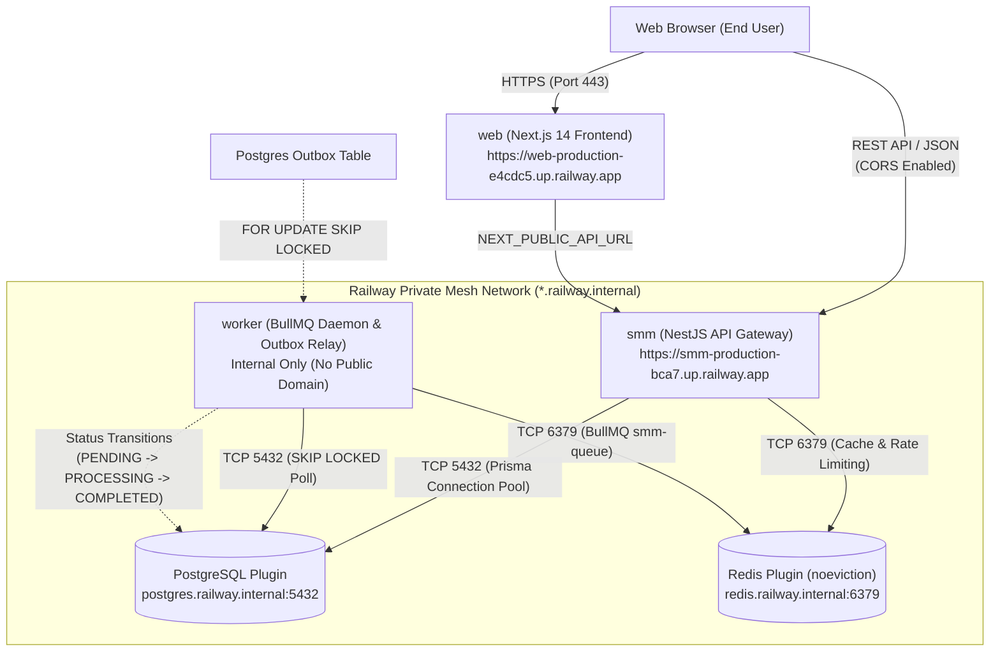

# SMM Panel Production Deployment Guide (Railway)

This document describes the complete architecture, configuration, operation, and maintenance procedures for the SMM Panel distributed system deployed on Railway.

---

## 1. System Architecture Diagram



---

## 2. Services & Databases Reference Matrix

| Service Name | Type | Railway Plugin / Template | Public URL | Internal Domain & Port | Primary Responsibilities |
| :--- | :--- | :--- | :--- | :--- | :--- |
| **`Postgres`** | Database | Railway PostgreSQL Plugin | *None (Private)* | `postgres.railway.internal:5432` | Primary relational database; transactions, orders, wallets, double-entry ledger, outbox events. |
| **`Redis`** | In-Memory Store | Railway Redis Plugin | *None (Private)* | `redis.railway.internal:6379` | BullMQ message broker (`smm-queue`), rate limiting counters, distributed cache (`maxmemory-policy: noeviction`). |
| **`smm`** | Backend API | Node.js (NestJS) | `https://smm-production-bca7.up.railway.app` | `smm.railway.internal:4000` | Public API gateway; JWT authentication, argon2id password hashing, order intake, wallet ledger, health checks. |
| **`worker`** | Background Worker | Node.js (BullMQ + Prisma) | *None (No HTTP listener)* | `worker.railway.internal` | Outbox event processor (every 5s), BullMQ worker (`smm-queue`), order fulfillment status engine. |
| **`web`** | Frontend Web App | Node.js (Next.js 14) | `https://web-production-e4cdc5.up.railway.app` | `web.railway.internal:3000` | User dashboard, catalog browsing, order submission, wallet interface, admin management. |

---

## 3. Environment Variables & Secret References

### 3.1 `smm` (API Service)
| Variable | Value / Reference | Purpose |
| :--- | :--- | :--- |
| `NODE_ENV` | `production` | Production runtime flags |
| `PORT` | `4000` | Application bind port (`0.0.0.0`) |
| `DATABASE_URL` | `${{Postgres.DATABASE_URL}}` | Railway dynamic reference to PostgreSQL private connection string |
| `REDIS_URL` | `${{Redis.REDIS_URL}}` | Railway dynamic reference to Redis private connection string |
| `FRONTEND_URL` | `https://web-production-e4cdc5.up.railway.app` | Allowed CORS origin |
| `JWT_SECRET` | *(Generated random 32-byte secret)* | JWT signature key |
| `JWT_ACCESS_SECRET` | *(Generated random 32-byte secret)* | Access token signing |
| `JWT_REFRESH_SECRET` | *(Generated random 32-byte secret)* | Refresh token rotation signing |
| `PASSWORD_PEPPER` | *(Generated random 32-byte secret)* | Argon2id pepper |
| `PROVIDER_KEY_SECRET` | *(Generated random 32-byte secret)* | Provider API encryption key |

### 3.2 `worker` (Worker Service)
| Variable | Value / Reference | Purpose |
| :--- | :--- | :--- |
| `NODE_ENV` | `production` | Production runtime flags |
| `DATABASE_URL` | `${{Postgres.DATABASE_URL}}` | PostgreSQL connection for outbox polling & order status transitions |
| `REDIS_URL` | `${{Redis.REDIS_URL}}` | BullMQ connection for `smm-queue` |
| `PROVIDER_KEY_SECRET` | `${{smm.PROVIDER_KEY_SECRET}}` | Shared encryption key for provider credentials |

### 3.3 `web` (Frontend Service)
| Variable | Value / Reference | Purpose |
| :--- | :--- | :--- |
| `NODE_ENV` | `production` | Production runtime flags |
| `PORT` | `3000` | Application bind port |
| `NEXT_PUBLIC_API_URL` | `https://smm-production-bca7.up.railway.app` | Public API endpoint for browser calls |

---

## 4. Deployment Order & Monorepo Build Dispatching

Railway is linked to the GitHub repository `vaibhavkumar955584-hub/smm` with automatic git-based triggers on `main`.

Because this is a pnpm monorepo, build and startup orchestration is driven by dynamic dispatcher scripts:
- **Build Dispatcher:** `scripts/build-service.js` (detects `RAILWAY_SERVICE_NAME` and builds targeted package: `@smm/api`, `@smm/worker`, or `@smm/web`).
- **Start Dispatcher:** `scripts/start-service.js` (detects `RAILWAY_SERVICE_NAME`, runs migrations/seeds on the API, and boots the container).

### Deployment Order:
1. **Databases:** Ensure `Postgres` and `Redis` plugins are online.
2. **Backend API (`smm`):** Deploys first; runs `prisma db push` and `scripts/seed.js` to ensure tables and baseline seed data exist.
3. **Background Worker (`worker`):** Deploys second; connects to PostgreSQL and Redis; begins processing outbox queue.
4. **Frontend (`web`):** Deploys third; compiles static pages with `NEXT_PUBLIC_API_URL` pointed to the online API.

---

## 5. Database Schema Synchronization & Seeding

Database migrations are managed via Prisma:
- **Container Boot Schema Sync:** `scripts/start-service.js` executes:
  ```bash
  pnpm exec prisma db push --skip-generate
  node scripts/seed.js
  ```
- **Manual Schema Synchronization (from developer machine):**
  If running directly against Railway:
  ```bash
  npx --yes @railway/cli run pnpm exec prisma db push
  ```
- **Idempotent Seeding:** `scripts/seed.js` uses `prisma.*.upsert()` for all categories, baseline services (`1042`, `2015`), and demo users, preventing duplicate key collisions across re-deployments.

---

## 6. Verification & Health Probes

### 6.1 API Health Probes
- **Liveness Probe:**
  ```bash
  curl -i https://smm-production-bca7.up.railway.app/health
  # HTTP 200 {"status":"ok","uptime":...}
  ```
- **Readiness Probe:**
  ```bash
  curl -i https://smm-production-bca7.up.railway.app/api/v1/health/ready
  # HTTP 200 {"status":"ready","services":{"database":"connected","redis":"connected"}}
  ```

### 6.2 Frontend Verification
- **Web App Root:**
  ```bash
  curl -i https://web-production-e4cdc5.up.railway.app
  # HTTP 200 (HTML document delivered)
  ```

### 6.3 End-to-End Flow Verification Script
Execute the test script stored in `scratch/test_order_worker.js`:
```bash
node scratch/test_order_worker.js
```
Expected output:
1. Registration returns HTTP 201 with generated PostgreSQL user UUID.
2. Balance adjustment credits ₹500 with double-entry ledger entry.
3. Order dispatch creates order with status `PENDING` and charge ₹18 deducted.
4. Worker picks up outbox event within 5s, updates order to `PROCESSING` and then `COMPLETED`.
5. Inspection returns `status: "COMPLETED"`, `startCount: 1000`, `remains: 0`.

---

## 7. Viewing Logs & Monitoring

Use the Railway CLI to stream logs from any service:

```bash
# View backend API logs
npx --yes @railway/cli logs -s smm --lines 50

# View background worker logs
npx --yes @railway/cli logs -s worker --lines 50

# View frontend web logs
npx --yes @railway/cli logs -s web --lines 50

# Check status of all project resources
npx --yes @railway/cli status
```

---

## 8. Rollback & Troubleshooting Guide

### 8.1 Rollback via Railway CLI
If a bad commit is pushed, rollback to the previous successful deployment instantly:
1. List deployments:
   ```bash
   npx --yes @railway/cli deployment list -s <smm | worker | web>
   ```
2. Redeploy previous deployment:
   ```bash
   npx --yes @railway/cli redeploy --deployment <DEPLOYMENT_ID>
   ```

### 8.2 Common Issues & Resolutions

| Symptom | Cause | Resolution |
| :--- | :--- | :--- |
| `502 Bad Gateway` on `smm` | App not bound to `0.0.0.0` or port mismatch | Confirm `apps/api/src/main.ts` calls `app.listen(port, "0.0.0.0")` and `PORT=4000` is set in Railway. |
| CORS error in browser | Frontend URL not allowed | Verify `FRONTEND_URL` on `smm` matches `https://web-production-e4cdc5.up.railway.app` without a trailing slash. |
| Worker fails with `PostgreSQL unreachable` | Private networking DNS lookup failed | Ensure `DATABASE_URL` reference `${{Postgres.DATABASE_URL}}` is configured on `worker`. |
| BullMQ `OOM` or evicted keys | Redis eviction policy evicting queue jobs | Verify Redis `maxmemory-policy` is set to `noeviction` (`CONFIG SET maxmemory-policy noeviction`). |
| `tsc: not found` during build | `devDependencies` stripped in production mode | Keep `production=false` in `.npmrc` so TypeScript compiler is available during Docker image assembly. |
