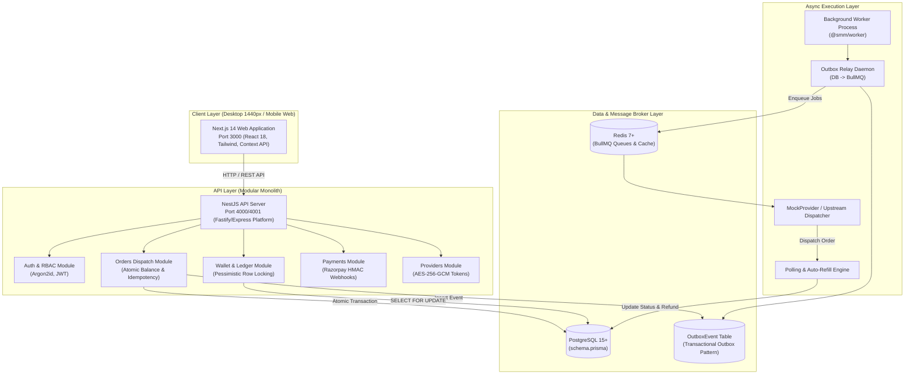

# 🌐 SMM Panel (Production Platform)

> **Enterprise-Grade Social Media Marketing Dispatch Platform & Reseller Infrastructure**  
> *Built with NestJS Modular Monolith, Next.js 14 App Router, PostgreSQL Invariant Engine, Redis Outbox Queue & Zero-Docker Architecture.*

---

## 📑 Table of Contents
1. [Overview & What It Is](#-overview--what-it-is)
2. [Core Feature Matrix](#-core-feature-matrix)
3. [System Architecture](#-system-architecture)
4. [Technology Stack](#-technology-stack)
5. [Prerequisites & Free Cloud Services](#-prerequisites--free-cloud-services)
6. [Step-by-Step Local Setup](#-step-by-step-local-setup)
7. [Demo Credentials (DEV ONLY)](#-demo-credentials-dev-only)
8. [Automated Verification & Gates](#-automated-verification--gates)
9. [Project Structure](#-project-structure)
10. [Known Limitations & Sandbox Details](#-known-limitations--sandbox-details)

---

## 🌟 Overview & What It Is

**SMM Panel** is an enterprise-grade automated dispatch system for social media growth services (Instagram, YouTube, TikTok, Telegram, X/Twitter, Spotify, LinkedIn). It provides dual-surface operations:

- **Customer Terminal:** Real-time catalog browsing, instant multi-tier wallet liquidity deposits (UPI, Cards, Netbanking), dynamic order vector configuration with client-side price quotes, automated status progression, and GST invoice generation.
- **Admin Command Center:** System telemetry, provider integration nodes with AES-256-GCM encrypted API tokens, order queue override/resend/refund tools, audit logs, and customer balance adjustments requiring mandatory justifications.
- **Financial Invariant Guarantee:** Double-entry ledger with database row-level locking (`SELECT ... FOR UPDATE`), strictly preventing negative balances, duplicate idempotency submissions, or duplicate order refunds.

---

## ⚡ Core Feature Matrix

| Feature Domain | Capabilities Implemented | Status |
| :--- | :--- | :--- |
| **Authentication & RBAC** | Argon2id password hashing, rotating JWT session tokens, refresh tokens, role-based access control (Admin / Customer). | MVP, verified in sandbox mode |
| **Service Catalog** | Platform filtering (Instagram, YouTube, TikTok, etc.), search, dynamic category trees, real-time rate per 1,000 calculation. | MVP, verified in sandbox mode |
| **Liquidity & Wallet** | Real-time balance queries, double-entry immutable ledger, tier deposit bonuses (+5% to +15%), GST statement export. | MVP, verified in sandbox mode |
| **Payment Gateway** | Razorpay integration flow (initiation, webhook HMAC signature verification, sandbox simulation completion endpoint). | MVP, verified in sandbox mode |
| **Orders Dispatch** | Atomic order creation, server-side price verification, pessimistically locked balance deduction, idempotency enforcement. | MVP, verified in sandbox mode |
| **Fulfillment Lifecycle** | Transactional outbox event pattern, provider dispatch queue, live status progression (`PENDING` -> `PROCESSING` -> `IN_PROGRESS` -> `COMPLETED`). | MVP, verified in sandbox mode |
| **Support Tickets** | Multi-category support desk, live customer & admin reply threads, ticket state lifecycle management (`OPEN`, `ANSWERED`, `CLOSED`). | MVP, verified in sandbox mode |
| **Admin Operations** | Provider CRUD with AES-256 encrypted keys, user balance adjustments with mandatory reasons, orders CSV export, announcements broadcast. | MVP, verified in sandbox mode |

---

## 🏗️ System Architecture



---

## 💻 Technology Stack

| Layer | Framework / Technology | Version (Strict Host Verified) |
| :--- | :--- | :--- |
| **Runtime** | Node.js | `v22.20.0` |
| **Package Manager** | pnpm | `12.10.1` |
| **Monorepo Manager** | Turborepo | `2.4.4` |
| **Frontend Web** | Next.js (App Router, React 18, TailwindCSS) | `14.2.35` |
| **Backend API** | NestJS Modular Monolith | `10.4.22` |
| **Database ORM** | Prisma Client & CLI | `5.22.0` |
| **Queue / Cache** | BullMQ & IORedis | `bullmq@5.81.5`, `ioredis@6.0.0` |
| **E2E Testing** | Playwright Test | `1.64.0` |
| **In-Memory Testing** | pg-mem & ioredis-mock | `pg-mem@3.0.14`, `ioredis-mock@8.13.1` |

---

## 📋 Prerequisites & Free Cloud Services

To run this platform in production or with live cloud backends (zero local installation needed):

| Component | Minimum Requirement | Free Hosted Provider Options |
| :--- | :--- | :--- |
| **Node.js** | `>= 20.0.0` | [Node.js Official](https://nodejs.org) |
| **pnpm** | `>= 9.0.0` | `npm install -g pnpm` |
| **PostgreSQL** | PostgreSQL 14+ | [Neon.tech](https://neon.tech) (Free tier) or [Supabase](https://supabase.com) (Free tier) |
| **Redis** | Redis 6.2+ | [Upstash Redis](https://upstash.com) (Free serverless tier) or [Redis Cloud](https://redis.com) |
| **Payment Gateway** | Razorpay Test Key | [Razorpay Dashboard](https://dashboard.razorpay.com) (Free sandbox account) |

---

## 🚀 Step-by-Step Local Setup

### Step 1: Clone & Install Workspace Dependencies
```bash
git clone <repository-url>
cd SMM
pnpm install
```

### Step 2: Environment Configuration
Copy the template configuration:
```bash
cp .env.example .env
```
*Note: In development and automated test modes, sandbox fallbacks activate automatically for unconfigured third-party credentials.*

### Step 3: Run Database Migrations & Seeds
```bash
npx prisma migrate dev --name init
npx prisma db seed
```

### Step 4: Run Services (No Docker Required)
You can start services concurrently via Turborepo or in separate terminals:

```bash
# Option A: Start all services via Turbo
pnpm dev

# Option B: Start services individually in separate terminals
# Terminal 1: REST API (Port 4000)
pnpm --filter @smm/api start:dev

# Terminal 2: Background Worker
pnpm --filter @smm/worker start:dev

# Terminal 3: Web Application (Port 3000)
pnpm --filter @smm/web dev
```

---

## 🔑 Demo Credentials (DEV ONLY)

> [!WARNING]
> These credentials are seeded for development and evaluation purposes ONLY. Never use these in a production environment.

| Role | Email | Password | Pre-seeded Wallet Balance | Permissions |
| :--- | :--- | :--- | :--- | :--- |
| **Customer** | `customer@smm.dev` | `Password123!` | ₹2,450.00 INR | Browse catalog, top-up funds, place orders, support tickets |
| **Root Admin** | `admin@smm.dev` | `AdminSecretPass123!` | N/A | Provider tokens, user balance adjustment, orders override, settings |

---

## 🛡️ Automated Verification & Gates

Run the automated verification suite to validate invariants, contracts, build targets, and end-to-end flows:

```bash
# 1. Authoritative 15-Stage Verification Gate (Contracts, Unit, Invariants, DAST, Builds)
pnpm verify:backend

# 2. End-to-End Smoke Test (Health, Register, Login, Sandbox Deposit, Place Order, Invariant Check)
pnpm smoke

# 3. Playwright Desktop 1440 E2E Proof (Customer Money Path, Admin Adjustments, Insufficient Funds Guard)
pnpm exec playwright test e2e/e2e-mvp-proof.spec.ts

# 4. Invariant Financial Unit Tests
pnpm --filter @smm/api test:invariants
```

---

## 📂 Project Structure

```
SMM/
├── apps/
│   ├── api/                    # NestJS REST API Modular Monolith
│   │   ├── src/
│   │   │   ├── common/         # PrismaService, Logger, Money util, HTTP Filters
│   │   │   ├── config/         # Environment validation schemas
│   │   │   └── modules/        # Auth, Wallet, Orders, Payments, Providers, Tickets, Users
│   │   └── test/               # Financial invariant suites (INV-01 to INV-15)
│   ├── web/                    # Next.js 14 App Router Web Client
│   │   ├── app/                # (auth), (customer), admin, marketing route groups
│   │   ├── components/         # Design system tokens, 3D Canvas, Customer & Admin UI
│   │   └── context/            # CustomerContext & AdminContext state machines
│   └── worker/                 # BullMQ asynchronous queue processor & outbox relay
├── packages/
│   ├── config/                 # Shared Tailwind, TypeScript, ESLint presets
│   └── contracts/              # Shared Zod schemas, calculation formulas, TypeScript DTOs
├── prisma/
│   ├── schema.prisma           # Authoritative database model definitions
│   └── seed.ts                 # Idempotent demo database seeder
├── scripts/
│   ├── verify-backend.js       # Authoritative 15-stage CI/CD gate
│   ├── smoke.js                # End-to-end sandbox smoke test runner
│   └── drills/                 # Chaos & financial integrity drills
├── docs/
│   ├── MVP_MATRIX.md           # Authoritative feature matrix with route & endpoint mapping
│   ├── KNOWN_LIMITATIONS.md    # Honest accounting of sandbox modes & deferred features
│   ├── SUBMISSION.md           # SRS compliance audit & evidence trail
│   ├── DEMO_SCRIPT.md          # 8-10 minute evaluator walkthrough script
│   ├── EXTERNALS.md            # External dependencies & cloud integration guide
│   └── GO_LIVE.md              # Production deployment checklist
└── e2e/                        # Playwright Desktop 1440 test specifications
```

---

## 🔍 Known Limitations & Sandbox Details

For an exhaustive audit of all development sandbox modes, fallback adapters, and deferred features, refer to [`docs/KNOWN_LIMITATIONS.md`](file:///d:/projects/internship%20projects/SMM/docs/KNOWN_LIMITATIONS.md).
