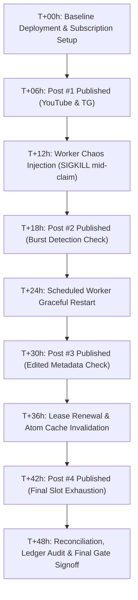

# AV5 Staging Soak Test Plan (48-Hour Real-World Qualification)

**Document:** `docs/AV5_STAGING_SOAK_PLAN.md`  
**Target Release:** `v-youpi-pilot-i1`  
**Target Environment:** Staging VPS (`smm-staging.internal`)  
**Mode:** Documentation & Scripts Only (No deployment without explicit operator command `deploy <release id>`)

---

## 1. Objectives & Scope
The 48-Hour Staging Soak exercises the Zero-Friction Autopilot engine under continuous real-world conditions without touching production user accounts or incurring unmetered upstream provider costs.

### Owned Test Channels:
1. **YouTube Test Channel:** Owned internal channel (e.g., `UC_test_smm_autopilot_internal`)
   - Detection Method: Official Atom / RSS feed poll (`https://www.youtube.com/feeds/videos.xml?channel_id=...`) and oEmbed resolution.
2. **Telegram Test Channel:** Owned internal public channel (e.g., `@smm_autopilot_staging_test`)
   - Detection Method: Telegram Official Bot API (`getUpdates` or webhook).
3. **Instagram / TikTok Fallback Verification:**
   - With scraping flags OFF (`ENABLE_INSTAGRAM_SCRAPING=false`), confirm user-submitted URLs route to deterministic paste-link fallback without crashing or unauthorized scraping.

---

## 2. Test Execution Timeline (48 Hours)



### Detailed Schedule:
- **T+00h:** Deploy release candidate to Staging behind feature flags (`AUTOPILOT_ENABLED=false`). Seed 2 test packages with 4 slots each for Alice (YouTube) and Bob (Telegram).
- **T+06h:** Publish Post #1 on YouTube & Telegram. Record published timestamp.
  - Expectation: Poller detects post within $\le 300\text{s}$, acquires Slot #1, creates drip executions.
- **T+12h (Chaos Step):** Worker Chaos Injection:
  - Trigger simulated post arrival.
  - Send `kill -9 <worker_pid>` during slot claim execution.
  - Worker automatically restarts via PM2/systemd.
  - Expectation: CAS ensures no duplicate slot claim; next tick recovers state safely.
- **T+18h:** Publish Post #2. Test burst scenario where 10 concurrent requests query `/packages/autopilot/preview`.
- **T+24h:** Worker restart test: Graceful shutdown via `SIGTERM`. Verify in-flight requests finish within graceful window.
- **T+30h:** Publish Post #3. Edit post title/caption immediately after detection.
  - Expectation: Media key remains immutable; post does NOT re-trigger or double-allocate slots.
- **T+36h:** WebSub / Atom lease verification and cache eviction test.
- **T+42h:** Publish Post #4 (completes the 4th and final slot).
  - Expectation: Package transitions from `ACTIVE` to `COMPLETED`; further posts are ignored; zero negative balances.
- **T+48h:** Ledger reconciliation audit. Verify `purchased = consumed + refunded + remaining` across all subscriptions.

---

## 3. Strict Pass / Fail Thresholds

| Metric | Target / Pass Threshold | Critical Failure Threshold |
| :--- | :--- | :--- |
| **Detection Lag (YouTube Atom)** | $\le 180\text{s}$ average (max $300\text{s}$) | $> 600\text{s}$ |
| **Detection Lag (Telegram Bot)** | $\le 60\text{s}$ average (max $120\text{s}$) | $> 300\text{s}$ |
| **Duplicate Slot Claims** | Exactly $0$ ($0.00\%$) | $\ge 1$ (FAIL) |
| **Missed New Posts** | Exactly $0$ | $\ge 1$ (FAIL) |
| **Double Dispatch / Upstream Orders** | Exactly $0$ ($0.00\%$) | $\ge 1$ (FAIL) |
| **Financial Ledger Discrepancy** | Exactly ₹0.00 difference | $> ₹0.00$ (FAIL) |
| **Worker Chaos Recovery** | Recovers within 1 polling tick ($\le 60\text{s}$) | Unhandled crash or stuck lock |
| **SSRF / Hostname Violations** | Zero private/loopback/metadata fetches | $\ge 1$ (CRITICAL BLOCKER) |

---

## 4. Automation & Monitoring Scripts

### 4.1 Soak Monitor Script (`scripts/soak_monitor.js`)
Polls database every 60 seconds during soak, tracking:
- Detection latency
- Execution statuses (`SCHEDULED`, `DISPATCHED`, `COMPLETED`, `FAILED`)
- Slot claim uniqueness
- Wallet balance ledger consistency

### 4.2 Chaos Injection Script (`scripts/soak_chaos.sh`)
```bash
#!/usr/bin/env bash
# Simulates sudden worker process termination during high-throughput polling
WORKER_PID=$(pgrep -f "apps/worker/dist/main.js")
if [ -n "$WORKER_PID" ]; then
  echo "[CHAOS] Killing worker PID $WORKER_PID mid-claim..."
  kill -9 "$WORKER_PID"
  echo "[CHAOS] Worker killed. Waiting for supervisor (PM2) auto-restart..."
fi
```

