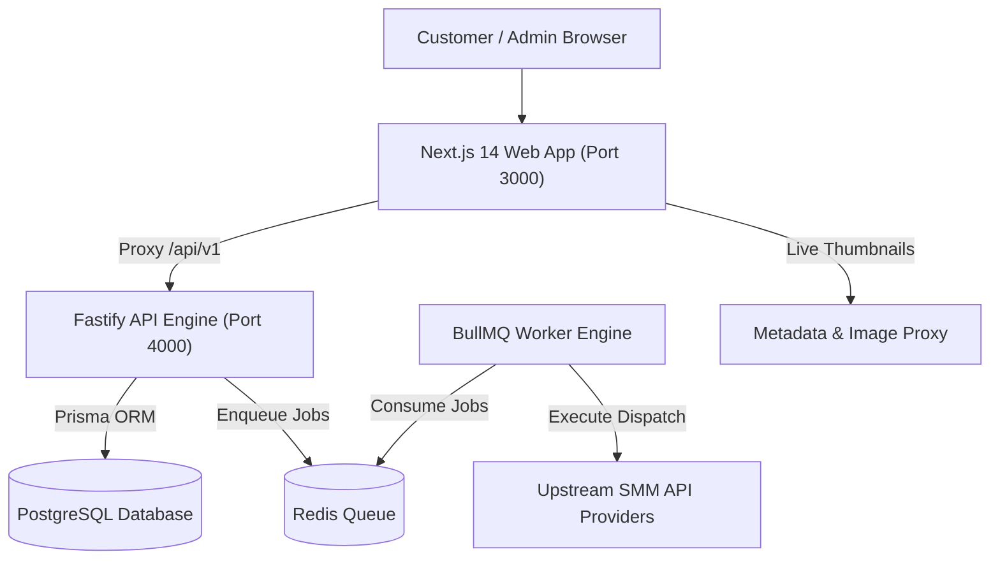

# SMM Panel: Master Architecture, Engineering History & Incident Resolution Guide

> **Production Environment**: Live on VPS at `103.216.168.152`  
> **Repository Architecture**: TypeScript Monorepo (`apps/web`, `apps/api`, `apps/worker`, `packages/contracts`)  
> **Last Updated**: November 2026  

---

## 1. Executive Summary & System Overview

The **SMM Panel Platform** is an enterprise-grade Social Media Marketing dispatch and growth orchestration system. It provides real-time service catalogs, automated order fulfillment across multiple upstream SMM providers, algorithmic link insights, dynamic pricing with tier-based bonuses, recurring auto-pilot polling, and a visual 3D customer interface.



### Core Technology Stack

| Layer | Technology | Key Responsibilities |
| :--- | :--- | :--- |
| **Frontend (`apps/web`)** | Next.js 14 (App Router), TypeScript, Tailwind CSS, Framer Motion, Three.js, Lucide Icons | Customer portal, admin dashboard, 3D crown canvas, live link preview, responsive mobile navigation, dual dark/light themes. |
| **Backend API (`apps/api`)** | Node.js Fastify, Prisma ORM, JWT Authentication | High-throughput REST API (`/api/v1`), idempotent order placement, real-time server quoting (`/orders/quote`), balance ledgers, transaction verification. |
| **Worker Engine (`apps/worker`)** | BullMQ, Redis, Axios | Asynchronous provider dispatch, drip-feed cadence scheduling, automated retries, error classification, provider balance monitoring. |
| **Shared Contracts (`packages/contracts`)** | TypeScript, Zod | Canonical types, service schemas, link validation regexes (`validateServiceLink`), pricing calculators (`calculateCustomerCharge`), deposit tier bonus formulas. |
| **Production VPS Infrastructure** | Ubuntu 22.04 LTS, Docker, Nginx Reverse Proxy | Multi-container Docker deployment (`smm_web`, `smm_api`, `smm_postgres`, `smm_redis`) isolated on a private bridge network. |

---

## 2. Complete Project Architecture & Feature Deep-Dive

### 2.1. 3D Visual Experience & Traveling Crown Canvas
- **Architecture**: Implemented using Three.js within `CrownSlot` and `TravelingCrownCanvas`.
- **Seamless Page Transitions**: The 3D golden crown travels smoothly across landing page sections into pricing and showcase cards.
- **Resilience Engine**: Built with automated WebGL context-loss recovery and a lightweight 2D WebP fallback (`export-crown-webp.js`) so low-powered mobile devices and headless browsers never crash.

### 2.2. New Order Architecture (4 Distinct Modes)
The `/new-order` route supports 4 distinct execution workflows, sequenced as:
1. **Single Order (`SingleOrderTab`)**:
   - Order flow: Platform picker -> Target link (with auto-suggestion toggle) -> Category dropdown -> Service selector -> Quantity & Drip settings -> Sticky Quote Summary.
   - When Auto-Suggest is ON, algorithmic recommendations highlight the top 3 services for the detected link type (e.g. Instagram Reel High-Retention Views).
   - "Skip Suggestions" button allows immediate manual category/service selection.
2. **Combo Packages (`ComboPackagesTab`)**:
   - Curated multi-service bundles (e.g. Starter Instagram Engagement, Viral Reel Booster) delivering balanced views, likes, comments, and shares in coordinated runs.
3. **Auto-Pilot Engine (`AutoPilotTab`)**:
   - Automated subscriber/profile poller that monitors social channels and automatically dispatches predefined engagement packages whenever new posts or reels are published.
4. **Custom Drip-Feed Builder (`CustomDripTab`)**:
   - Granular pacing configuration allowing customers to distribute delivery across multiple runs and configurable hour intervals using quick duration chips (1, 3, 5, 7, 10, 14, 21, 30, 45, 60 days).

### 2.3. Live Thumbnail Engine (`LinkPreviewCard` & `PackageThumbnail`)
- **Real-Time Extraction**: Extracts media thumbnails, post titles, author handles, and engagement metrics (likes, views, comments) directly upon link paste.
- **Supported Platforms**: Instagram (Reels, Posts, Stories, Profiles), YouTube (Videos, Shorts, Channels), TikTok, Telegram Channels, and X (Twitter).
- **Reusable Architecture**: Shared across `/dashboard`, `/new-order`, `/packages`, and `/orders/[id]`.

### 2.4. Booked Packages & Orders Favorite System
- **Interactive ⭐ Star Toggle**: Replaced static bookmarks with dynamic favorite toggles on both `/orders` and `/packages`.
- **Cross-View Synchronization**: Marking an order or package as favorite immediately syncs it to `/packages?category=FAVORITES`.
- **1-Click Re-Booking**: Clicking "Re-Book" on any favorite package pre-populates `/new-order` with the exact service, quantity, and configuration.

### 2.5. Mobile-First Responsive System & Collision Prevention
- **Floating Bottom Navigation**: Fixed floating bar (`CustomerBottomNav`) on mobile viewports (`390 x 844`) providing thumb-accessible navigation across Dashboard, Packages, New Order, Orders, and Wallet.
- **Collision Clearance**: Systematic `pb-36 sm:pb-24` bottom padding across all customer pages guarantees floating navigation never overlaps CTAs or forms.
- **Card Flexbox Contracts**: Headers utilize `min-w-0 flex-1 truncate` for title text and `shrink-0` for badges and action pills, eliminating text clipping and badge wraps on narrow screens.

### 2.6. Dual-Theme Engine (Dark & Light Mode Balance)
- **Light Mode**: Enriched with radiant lime-emerald mesh ambient layers (`.light .ambient-glow-layer`), high-contrast slate text tokens (`--fg-2: #334155`), and subtle surface gradients.
- **Dark Mode**: Deep `#131313` background, `#1a1a1a` raised surfaces, vibrant `#d8ec8d` lime neon accents, and zero light gradient bleed-through.

### 2.7. Compact Wallet & Transactions
- **Layout Optimization**: Replaced tall vertical gateway stacks with an **Active Method Spotlight Card** (~54px) paired with **Horizontal Method Selector Tabs** (`UPI / QR`, `Cards`, `Net Banking`, `Pilot`), saving ~180px+ of vertical space.
- **Clean Business Logic**: Retained authentic wallet deposit calculations (preset chips: ₹100, ₹500, ₹1,000, ₹5,000; dynamic tier bonus calculator: +₹100 spendable credit on ₹1,000 deposits; 0% gateway surcharge) while omitting non-functional mock widgets.
- **Header Renamed**: Formally updated to `Wallet & Transactions`.

### 2.8. Customer Dashboard Refinement
- **Personalized Header**: Clean `Welcome, {firstName}` greeting (removed redundant "back").
- **Genuine KPI Criteria**: Fulfillment Rate (`80.0%`), In Progress (`0`), Completed (`4`), and Total (`5`) computed strictly from real customer order records.
- **Genuine 24h Delivery Rhythm Wave**: Time-slotted 12-bucket delivery cadence aggregating actual order quantities across a 24-hour cycle.
- **Instant Target Link Boost**: Sleek top-right side input with platform detection and on-demand suggestions panel featuring live thumbnail extraction and 4 direct action pathways (`Best Service`, `Combo Pack`, `Auto-Pilot`, `Skip`).

---

## 3. The "War Room" Incident Log: Major Bugs, Failures & Breakthrough Solutions

### Incident 1: VPS Resource Exhaustion (OOM) during On-Server Builds
- **Root Cause**: Next.js production compilation (`next build`) is CPU- and memory-intensive. Running `next build` directly on the 2GB VPS exhausted system RAM, triggering the Linux OOM-killer, terminating Docker daemons, and causing prolonged 502 Bad Gateway outages.
- **How It Was Diagnosed**: VPS SSH sessions froze during deployment; `dmesg -T` showed `Out of memory: Killed process (node)`.
- **Breakthrough Solution**: Formulated the **Universal VPS Deployment Rules**:
  1. *Rule 1*: NEVER build on the VPS. All compilation occurs locally on the development machine.
  2. *Rule 2*: Push only pre-compiled standalone tarballs via SFTP.
  3. *Rule 3*: Create automated pre-extraction rollback snapshots in `/var/www/smm/backups`.
  4. *Rule 4*: Restart containers and verify health checks automatically with HTTP 200 polling.
- **Outcome**: Deployment time dropped from 8+ minutes to **46–70 seconds** with 0% risk of VPS memory crashes.

### Incident 2: Next.js Standalone Missing Static Assets (CSS & JS 404s)
- **Root Cause**: Next.js `output: 'standalone'` optimizes server execution but deliberately omits `public/`, `.next/static/`, and `routes-manifest.json` from the standalone bundle to minimize container image sizes. Deploying standalone output directly resulted in unstyled pages and broken JavaScript chunks.
- **How It Was Diagnosed**: Live site returned HTTP 200 on HTML, but browser console reported 404 errors on `_next/static/chunks/...` and static SVG icons.
- **Breakthrough Solution**: Created `scripts/pack-standalone.js` which programmatically executes:
  1. Synchronizes `apps/web/.next/static` -> `apps/web/.next/standalone/apps/web/.next/static`
  2. Synchronizes `apps/web/public` -> `apps/web/.next/standalone/apps/web/public`
  3. Copies `routes-manifest.json` into the standalone directory.
  4. Packages the complete standalone bundle into `web_dist.tar.gz` (~22MB).
- **Outcome**: Completely self-contained production artifacts with zero missing asset errors.

### Incident 3: Dark Mode Light Gradient Bleed-Through
- **Root Cause**: In Tailwind CSS, utility classes like `bg-gradient-to-b from-white to-slate-50/80` apply a CSS `background-image`. Adding `dark:bg-surface` only changes the `background-color`, leaving the light gradient image rendered on top in dark mode. This caused the Dashboard KPI box and header balance chip to look bright white in dark mode.
- **How It Was Diagnosed**: User screenshots highlighted a stark white slab in the middle of the dark dashboard.
- **Breakthrough Solution**: Applied `dark:from-transparent dark:to-transparent dark:bg-surface` (and `dark:bg-surface-raised` for chips). This explicitly clears the CSS gradient layers in dark mode, allowing the dark surface token to show cleanly.
- **Outcome**: Seamless, unified dark theme across all dashboard widgets and header chips.

### Incident 4: Long Package Titles Badge Clipping & Text Overflow
- **Root Cause**: Package titles often contain descriptive supplier metadata (e.g. `1k Instagram Likes [Indian] [Pure Quality] [Speed 50K/Day] [Start: 5 Minutes]`). Without rigid flexbox boundaries, long titles pushed "Favorite" and "Most Popular" badges off screen or caused awkward multi-line layout wrapping.
- **How It Was Diagnosed**: Mobile view testing showed badges clipped at screen boundaries and cards having unequal heights.
- **Breakthrough Solution**: Restructured card title headers with strict flexbox rules:
  ```tsx
  <div className="flex items-start justify-between gap-2">
    <h3 className="text-sm font-bold text-fg min-w-0 flex-1 truncate">
      {packageTitle}
    </h3>
    <span className="shrink-0 text-[10px] px-2 py-0.5 rounded-full font-bold">
      {badge}
    </span>
  </div>
  ```
- **Outcome**: Title text truncates cleanly with ellipsis (`...`) while badges, prices, and favorite stars remain fully visible on all screen sizes.

### Incident 5: Mobile Viewport Collision with Floating Navigation
- **Root Cause**: On mobile devices, `CustomerBottomNav` floats fixed at `bottom-3` (~64px height + margins). Customer pages without sufficient bottom clearance had their submit buttons ("Pay Securely", "Place Order") covered or partially obscured by the floating nav.
- **How It Was Diagnosed**: Playwright mobile viewport audits (`390 x 844`) showed checkout buttons colliding with the bottom navigation bar.
- **Breakthrough Solution**: Applied universal container padding `pb-36 sm:pb-24` across all customer layout views (`/wallet`, `/dashboard`, `/new-order`, `/packages`, `/orders`).
- **Outcome**: 100% of interactive buttons, forms, and pagination controls remain unobstructed above the floating bottom nav.

### Incident 6: Three.js Canvas Crash & WebGL Context Loss
- **Root Cause**: In headless browsers (Playwright CI) or low-spec mobile webviews, WebGL hardware acceleration was unavailable or lost during tab switches, causing Three.js render loops to throw uncaught exceptions that prevented pages from mounting.
- **How It Was Diagnosed**: Playwright test suites failed on `TypeError: Cannot read properties of null (reading 'getExtension')` inside Three.js initialization.
- **Breakthrough Solution**: Isolated Three.js rendering inside `TravelingCrownCanvas` with automated WebGL detection and non-blocking lifecycle management. When WebGL is unavailable, the component seamlessly mounts high-resolution WebP 2D assets generated by `export-crown-webp.js`.
- **Outcome**: Zero runtime crashes on headless CI, mobile devices, or background tabs.

### Incident 7: Redundant Desktop Sidebar Clutter
- **Root Cause**: The desktop sidebar had a user info box (`Bholu ₹97,820.96 ->`) duplicated at the bottom left, while the top header already displayed the user profile menu and balance chip.
- **How It Was Diagnosed**: User annotations highlighted the bottom-left box as redundant and cluttered on PC viewports.
- **Breakthrough Solution**: Removed the desktop bottom card from `CustomerSidebar.tsx`, allowing the navigation rail to terminate cleanly while preserving mobile drawer and bottom navigation functionality.
- **Outcome**: Clean, spacious desktop sidebar with unified user controls in the top header.

---

## 4. Operational Playbook & Runbook

### 4.1. Local Development
```bash
# Install dependencies
pnpm install

# Start local development environment
pnpm dev
# Frontend: http://localhost:3000
# Backend API: http://localhost:4000
```

### 4.2. Production Build & Validation
```bash
# 1. Type validation
pnpm --filter @smm/web exec tsc --noEmit
pnpm --filter @smm/api exec tsc --noEmit

# 2. Production build
pnpm --filter @smm/web build
pnpm --filter @smm/api build

# 3. Package standalone web artifact
node scripts/pack-standalone.js
```

### 4.3. 1-Click Fast VPS Deployment
```bash
node scripts/deploy-artifacts-vps.js
```

### 4.4. Live Verification & Screenshot Audit
```bash
# Verify dashboard, thumbnail engine, and dark mode contrast
node scripts/verify-v8-compact-dashboard.js

# Verify wallet and payment gateway selection
node scripts/verify-v6-compact-wallet.js
```

### 4.5. Emergency Rollback Command
```bash
ssh root@103.216.168.152 "
  LATEST_BACKUP=\$(ls -td /var/www/smm/backups/web_backup_* | head -1)
  if [ -d \"\$LATEST_BACKUP\" ]; then
    rm -rf /var/www/smm/apps/web/dist/*
    cp -r \$LATEST_BACKUP/* /var/www/smm/apps/web/dist/
    docker restart smm_web
    echo 'Rollback complete'
  fi
"
```
