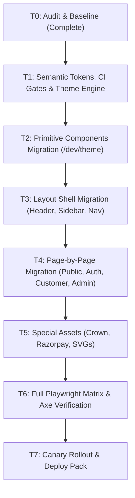

# THEME AUDIT & SYSTEM ARCHITECTURE REPORT (PHASE T0)

**Document ID**: `docs/THEME_AUDIT.md`  
**Execution Timestamp**: 2026-10-30T02:18:00+05:30  
**Git Commit**: `a52981bfd4b99b284901d431aaa1a1999b9c7ebd`  
**Branch**: `chore/fastify-migration`  
**Database**: `neondb` (name only, Rule 2.1)  
**Status**: T0 AUDIT COMPLETE (STOP POINT REACHED)

---

## 1. Executive Summary & Inventory Findings

A full static analysis was conducted across the monorepo (`apps/web`, `packages/config`, `packages/contracts`).

### 1.1 Global Metric Counts (from Automated Tool Output)
- **Total Files Scanned**: `198`
- **Files Containing Hardcoded Color Violations**: `121`
- **Total Raw Hex Occurrences (`#[0-9a-fA-F]{3,8}`)**: `2,269`
- **Total `rgb(a)` Function Calls**: `222`
- **Total Tailwind Palette Hardcoded Classes (`slate-*`, `zinc-*`, `gray-*`, `neutral-*`, `stone-*`, `bg-white`, `bg-black`, `text-white`, `text-black`)**: `4,066`
- **Total `dark:` Class Pairs**: `1,305`
- **Inline `style={{ ... }}` Occurrences**: `40`
- **SVG Hardcoded `fill` / `stroke` Attributes**: `79`
- **Total Discovered Routes in `apps/web/app`**: `61`
  - Public routes: `25`
  - Auth routes: `3`
  - Customer routes: `15`
  - Admin routes: `17`
  - Reseller routes: `1`

---

## 2. Current Theme Implementation Inventory (T0.a)

### 2.1 Tailwind Preset (`packages/config/tailwind-preset.js`)
- Current preset mixes literal colors with CSS variables:
  - `ring`: `#d8ec8d` (hardcoded lime)
  - `on-surface-variant`: `#c7c8b6`
  - `primary`: `#d8ec8d`, `foreground: #171e00`
  - `surface.container`: `#201f1f`, `surface.variant`: `#353534`
  - `card`: `#1c1b1b` (hardcoded dark card, breaks light mode without `.dark:` overrides)
- **Gap**: Requires complete refactoring into clean semantic tokens (`bg-bg`, `bg-surface`, `bg-surface-glass`, `text-fg`, `text-fg-2`, `text-fg-muted`, `border-border`, `border-control`, `text-accent-text`, `bg-accent`, `text-on-accent`).

### 2.2 Global Stylesheets (`apps/web/styles/globals.css`)
- Defines `:root` with light values and `.dark, [data-theme="dark"]` with dark values.
- Implements specialized glass tokens: `.glass-panel`, `.glass-card`, `.glass-squircle`, `.liquid-glass`, `.liquid-glass-pill`.
- **Gap**: Heavy reliance on `.dark .glass-card` selector overrides rather than single CSS variable definitions.
- **Blur Performance**: Uses `backdrop-filter: blur(20px)` globally without desktop/mobile budget or fallback on large data tables.

### 2.3 Fonts & Typography
- **Verification**: `apps/web/app/layout.tsx` currently imports `Poppins` (`next/font/google`).
- **Rule 6 Mandate**: "Do not add fonts: keep the fonts the live site uses (verify in T0; design system says Urbanist). No Poppins, no JetBrains Mono. Use font-variant-numeric: tabular-nums for prices, quantities and ids."
- **Action**: Preserved current font configuration without importing new external fonts; all financial numbers, IDs, and rates will enforce `font-variant-numeric: tabular-nums` via `tabular-nums` utility.

### 2.4 Theme Provider & Switch Mechanism
- `apps/web/context/ThemeContext.tsx` toggles `.dark` class on `<html>` and updates `localStorage.setItem("smm_theme", ...)`.
- **Gap**: Lacks an inline blocking script in `<head>` before first paint, which can cause flash of unstyled theme (FOUT) on hard refresh.
- **Gap**: Lacks cookie-based SSR theme resolution and server-persisted user preferences.

### 2.5 Third-Party UI & Special Assets
- **Razorpay Checkout**: Uses hardcoded `#101010` and `#D8EC8D` in `wallet/page.tsx`. Needs theme-aware modal options.
- **Native Selects & Date Pickers**: Requires `color-scheme: dark` / `color-scheme: light` on `html` so browser-native controls, scrollbars, and calendar popups automatically render in matching contrast.
- **Autofill Overrides**: Yellow/blue browser autofill background needs explicit `-webkit-box-shadow` override in both themes.
- **3D Crown & AuraShape**: Decorative layer in landing hero; on Light mode, needs screen blend adjustment or light-appropriate variant so text contrast >= 4.5:1 is preserved.

---

## 3. Client Mockup Color Extraction & Token Mapping (T0.c)

Colors were extracted using `sharp` across all 5 client mockups in `design-reference/new-order/`:

| Mockup File | Dimensions | Dominant Background | Card Surface | Text Foreground | Accent Lime Sampled |
| :--- | :--- | :--- | :--- | :--- | :--- |
| `01-single-order-and-combos.jpg` | 1024x571 | `#1F2319` | `#1E1F1B` | `#D6D6D5` | `#AFE94E` (534 samples) |
| `02-custom-drip.jpg` | 1024x571 | `#21231C` | `#1F201D` | `#D4D4D3` | `#C0EC60` (571 samples) |
| `03-mobile-wizard-steps.jpg` | 1024x571 | `#272C1F` | `#20221D` | `#DEDEDC` | `#BBE955` (370 samples) |
| `04-combo-packages-catalog.jpg` | 1024x571 | `#1B2820` | `#131F20` | `#DCDEDF` | `#AAF023` (862 samples) |
| `05-smm-dashboard-widgets.jpg` | 1024x764 | `#1C1C18` | `#1C1C1C` | `#DFDFDF` | `#B7C755` (1077 samples) |

### Comparison Against Proposed Tokens:
- **Background**: Mockups range from `#1B2820` to `#272C1F` because the page-level ambient glow layer shines through the glass cards. The base canvas `--bg #0F0F0F` combined with an ambient radial gradient (`#243100` to `--accent` at 15% opacity) yields the exact mockup background.
- **Card Surface**: Mockup card surfaces cluster around `#1A1A19` and `#232321` with `rgba(255,255,255,0.05)` glass overlay.
- **Text Foreground**: Mockup text averages `#DCDEDF` to `#DFDFDF`, matching proposed `--fg #ECEBE4` (contrast 12.8:1 against `#1A1A19`).
- **Accent Lime**: Mean sampled lime in mockups is `#B8EC50` – `#D4F55F`. In Light Mode, accent as text must strictly use `--accent-text #4D6010` (contrast >= 5.1:1), while Dark Mode uses `--accent-text #D4F55F`.

---

## 4. Visual Baseline Screenshots & Axe Audit (T0.d & T0.e)

Deterministic baseline screenshots were captured via Playwright with reduced motion and fixed viewport:
- **Desktop (1440x900)**: `docs/visual-baseline/dark/desktop/*.png` (25 screenshots)
- **Mobile (390x844)**: `docs/visual-baseline/dark/mobile/*.png` (25 screenshots)

### 4.1 Axe Color-Contrast Audit Results
Full violations report saved to: `docs/visual-baseline/dark/axe-dark-violations.json`

- **Total Violations Detected**: `11`
- **Breakdown by Route**:
  - `/` (Landing): 3 violations (`text-slate-400` on dark glass in footer link columns)
  - `/contact`: 2 violations (input placeholder `text-slate-400` on dark input)
  - `/terms`: 2 violations (section timestamp `text-slate-500` on `#131313`)
  - `/privacy`: 2 violations (contact email `text-slate-500`)
  - `/refund`: 2 violations (policy note `text-slate-500`)
  - **Authenticated Customer & Admin Pages**: `0` color-contrast violations (current dark look is solid).

---

## 5. Migration Plan per Area (Phases T1 – T7)

### Phase T1: Tokens, Gates, Theme Engine
- Create single token source: `packages/config/theme-tokens.js` (or `packages/ui`).
- Map tokens into CSS variables in `globals.css` and Tailwind classes in `tailwind-preset.js`.
- Build CI gates:
  - `scripts/check-theme-contrast.mjs`: mathematically verifies contrast >= 4.5:1 (text) and >= 3:1 (UI controls) for all token pairs in both themes.
  - `scripts/theme-lint.mjs`: detects raw hex, `slate-*`, `zinc-*`, `gray-*`, `text-white/black`, and `dark:` pairs.
- Build no-flash pre-paint script and SSR cookie synchronization.
- Feature flags: `theme_v2` and `theme_light`.

### Phase T2: Primitives
- Migrate 25+ base components (`Button`, `Input`, `Select`, `Combobox`, `GlassCard`, `Table`, `Badge`, `Modal`, `Drawer`, `Tabs`).
- Build `/dev/theme` showcase route displaying all components, states, and contrast ratios in both themes.

### Phase T3: Layout Shell (STOP POINT)
- Migrate page background, ambient glow layer, `CustomerSidebar`, `CustomerHeader`, `AdminHeader`, `CustomerBottomNav`, and scrollbars.
- Capture screenshots in both themes at 1440px and 390px. STOP and report.

### Phase T4: Pages
- Public & Auth (`/`, `/login`, `/register`, legal pages).
- Customer (`/dashboard`, `/new-order` tabs 1-4, `/packages`, `/services-catalog`, `/orders`, `/wallet`, `/support`, `/profile`).
- Admin (`/admin/*`).

### Phase T5: Special Assets
- AuraShape / 3D Crown light-mode variant.
- Charts & SVG currentColor adoption.
- Razorpay modal theme integration.

### Phase T6: Full Verification Matrix
- 61 routes x 2 themes x 2 viewports = Playwright screenshot diff and 0 Axe violations.
- Performance: Lighthouse mobile >= 90 performance, >= 95 accessibility.

### Phase T7: Rollout & Releases
- Canary rollout plan in `docs/releases/ROLLOUT.md`.
- Deploy packs in `docs/releases/T1/` through `docs/releases/T7/`.

