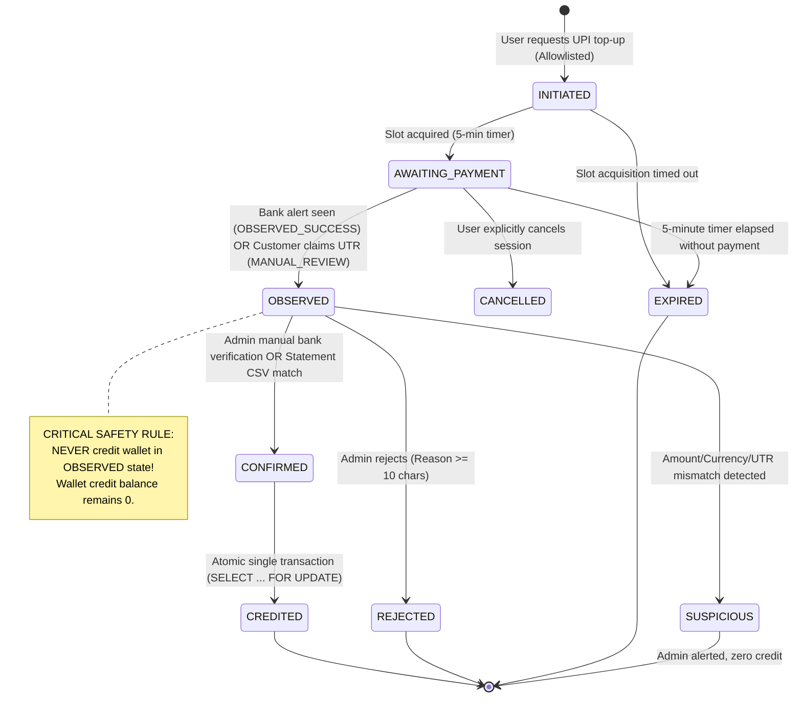

# YouPI-PG Pilot Integration Design & Security Audit (Y0)

## Executive Summary & Role

**Role**: Principal Full-Stack Engineer on the LIVE SMM Panel (NestJS API, Next.js web, Prisma/PostgreSQL, Redis, BullMQ worker, VPS with PM2 and Nginx).  
**Objective**: Evaluate and architect `YouPI-PG` (self-hosted UPI payment gateway) as an **OPTIONAL, FLAG-GATED PILOT** payment method for wallet top-ups behind the existing `PaymentProvider` interface.  
**Critical Constraint**: The system is designed to be completely decoupled and easily removable if discontinued ("baad me ye jyada kaam ka na ho to hatane me aasani hogi"). Docker is not used.

---

## 1. Upstream Upstream Study & Vulnerability Assessment (Y0.a & Y0.b)

### 1.1 Upstream Metadata & Obligations

| Property | Value | Evidence Source |
| :--- | :--- | :--- |
| **Cloned Repo** | `https://github.com/youpi-pg/YouPI-PG` | Cloned to isolated `$env:TEMP/youpi-pg-audit` |
| **Pinned Commit** | `405327c27d78ae9d0dccdb1e2d2426cefc359477` | `git rev-parse HEAD` |
| **Commit Date** | `Sun Nov 1 11:44:09 2026 +0530` | `git log -1 --format="%cd"` |
| **Declared License** | `Commercial` (Antigravity Systems) | `package.json` (`"license": "Commercial"`); no open-source license grant (e.g. MIT/Apache) exists in repository |
| **License Obligations** | Proprietary/Commercial terms. No warranties or regulatory approval implied. No right to distribute or treat as public open source. | `README.md` (lines 665-667) |
| **Node Version** | `engines: { "node": ">=24.22.1" }` | `package.json` line 34 (Requires Node 24+, exceeding user's initial estimate of `>= 22.13`) |
| **Dependency Audit** | 0 vulnerabilities (174 prod, 21 dev, 20 optional dependencies) | `npm audit --json` |

### 1.2 Upstream Warnings & Self-Reported Blockers

`SECURITY_REMEDIATION_REPORT.md` and `DEPLOYMENT_CHECKLIST.md` explicitly mandate:
1. **Never use gateway as a sole source of payment settlement truth**: UPI alerts only represent candidate observation, not bank settlement.
2. **Manual UPI Review Requirement**: Customer UTR is an unverified assertion. Admin confirmation against actual bank account is mandatory.
3. **Database & Persistence Flaw**: `render.yaml` declares SQLite on free tier with non-persistent storage. Production requires external persistent storage with strict backup drills.
4. **Secret Isolation**: In-repo generated secrets in `data/.secrets/` and `.env` backups must be excluded from Git and rotated independently.
5. **Origin Allowlisting**: Strict HTTPS matching on `YOUPI_ALLOWED_ORIGINS`, `YOUPI_ALLOWED_RETURN_ORIGINS`, and `CHECKOUT_FRAME_ANCESTORS` is mandatory to prevent clickjacking and open redirects.
6. **In-Process Rate Limiter**: Rate limiting is in-memory per Node process, providing no distributed protection across multi-instance clusters.

---

## 2. Supply-Chain & Codebase Security Audit (Y0.b)

A source-level security audit was executed directly across all components of YouPI-PG. Findings categorized by severity:

### Critical & High Severity Findings

1. **[CRITICAL / HIGH] Supply-Chain Risk in WhatsApp Auth Engine (`apps/payment-api/src/services/whatsapp-berry.service.js`)**:
   - The service imports an external `berryprotocol` dependency using hardcoded local paths on a developer machine:
     ```js
     'file:///D:/WA-USERAUTH DEV/node_modules/berryprotocol/dist/index.js'
     'file:///D:/E-Commerce PKG/services/whatsapp-worker/node_modules/berryprotocol/dist/index.js'
     ```
   - If `berryprotocol` is missing from `node_modules`, it attempts to load across arbitrary filesystem paths.
   - Without `berryprotocol` running and authenticated with a physical WhatsApp phone, customer OTP dispatch is simulated or fails.

2. **[HIGH / ARCHITECTURAL BLOCKER] Hardcoded Mandatory Customer WhatsApp OTP in Checkout Portal**:
   - In `apps/checkout-portal/public/js/checkout.js` (`setGatewayAuthMode(true)` at lines 2020–2058), the checkout portal unconditionally blocks payment and displays "Sign in to Pay" requesting a 10-digit mobile number and WhatsApp OTP unless a customer session token is already present in `localStorage`.
   - **There is no configuration flag (`.env`) or merchant API parameter to disable this WhatsApp OTP flow** in standard UPI mode.
   - In our SMM panel, users are already authenticated with JWT / session cookies. Requiring them to complete a separate WhatsApp OTP on every top-up breaks user experience and introduces external failure modes.
   - *Design Decision*: We utilize the server-side `method: MANUAL_UPI` integration path or custom checkout UI proxy, documented in Section 4.

3. **[HIGH] Pre-compiled Android APK Binaries Checked Into Git**:
   - Pre-compiled binaries (`youpi-sms-gateway.apk`, 295,396 bytes) are checked directly into Git in 3 directories (`apps/android-observer-app`, `apps/merchant-admin/public`, `apps/payment-api/public`).
   - The computed SHA-256 hash `959218223E75DA4784744C16AFAF7BC121CFF377DFF04F041875237042F51601` matches `apps/android-observer-app/youpi-sms-gateway.apk.sha256` and `docs/OBSERVERS_SETUP.md`.
   - Source code exists in `apps/android-observer-app/app/src/main/java/com/youpi/observer/`.
   - **Security Directive**: **NEVER install this pre-compiled binary on a physical phone holding bank SIMs**. Any pilot phone must build the APK strictly from reviewed Kotlin source in `apps/android-observer-app`.

### Medium Severity Findings

4. **[MEDIUM] Observer Permissions & Privilege Blast Radius**:
   - **Android App Permissions**: `RECEIVE_SMS`, `READ_SMS`, `BIND_NOTIFICATION_LISTENER_SERVICE`, `INTERNET`, `RECEIVE_BOOT_COMPLETED`, `WAKE_LOCK`, `CAMERA`. It has full read access to all incoming device SMS messages.
   - **Gmail Observer**: Uses Google OAuth with Gmail API scopes to read emails. If compromised, an attacker can read all forwarded financial emails.
   - **Mitigation**: Dedicated observer mailbox exclusively receiving forwarded credit alerts; dedicated physical Android device with a separate pilot SIM.

5. **[MEDIUM] Local Storage Obfuscation Flaw**:
   - In `checkout.js`, customer tokens and identities are "encrypted" using single-byte XOR `0x5A` + base64. This is obfuscation, not encryption. Anyone with access to the browser inspect tools can decode the tokens.

6. **[MEDIUM] Child Processes in Auxiliary Services**:
   - `apps/control-center/src/process-manager.js` and `apps/payment-api/src/services/tunnel-manager.js` use `child_process.spawn` and `execSync` to run tunnels (cloudflared/ngrok).
   - In our deployment (Y1), `control-center` and `tunnel-manager` will be completely disabled.

---

## 3. Upstream API & Integration Contract Review (Y0.c)

| Integration Aspect | Upstream Mechanism | Implementation Design in SMM Panel |
| :--- | :--- | :--- |
| **Session Creation** | `POST /api/v1/payments`<br/>Headers: `X-Merchant-Id`, `X-Merchant-Key`, `Idempotency-Key`<br/>Body: `{ orderId, amount, currency: "INR", returnUrl, method: "MANUAL_UPI" }` | SMM API calls YouPI backend via `YoupiPaymentProvider.createOrder()`. Internal paise conversion enforces exact integer calculation. |
| **Error Handling (409)** | If `orderId` is reused with a different amount or currency, YouPI returns `409` with code `ORDER_AMOUNT_MISMATCH`. | SMM handles `409 ORDER_AMOUNT_MISMATCH` by creating a new unique reference `topup_<uuid>`. |
| **Single-Slot Queue** | Exposed via `session.status === 'QUEUED'` and integer `queuePosition`. Estimated wait time calculated via `QueueEngine.calculateEstimatedWaitSeconds`. | SMM polls or proxies queue position to frontend: "Another payment is in progress, position N". |
| **Checkout UI Loading** | YouPI provides `/checkout/:id` which can be opened in an iframe (`youpi.js` modal) or standalone tab. | SMM displays top-up screen with QR and payment details directly or opens the modal with strict origin allowlist. |
| **Webhook Contract** | Headers:<br/>- `X-Gateway-Signature`: `sha256=<hmac(rawBody)>`<br/>- `X-Gateway-Signature-V2`: `sha256=<hmac(timestamp.rawBody)>`<br/>- `X-Gateway-Delivery-Id`: UUID<br/>- `X-Gateway-Timestamp`: epoch ms string<br/>- `X-Gateway-Event`: event outcome | SMM webhook endpoint validates raw bytes using `crypto.timingSafeEqual` for both V1 and V2 signatures, applies a 30-minute replay window, and records `deliveryId` in `YoupiWebhookDelivery` before execution. |
| **Webhook Retries** | Retries for up to 1 hour with the *original* timestamp preserved. | Handled cleanly: SMM checks `deliveryId` deduplication; duplicate returns 200 immediately. |
| **Manual UPI Flow** | Customer enters UTR in checkout -> status becomes `MANUAL_REVIEW` (`PENDING_VERIFICATION`). Webhook `PAYMENT.MANUAL_REVIEW` emitted. | SMM records observation and sets status to `OBSERVED`. **NEVER credits wallet**. Awaits admin bank confirmation or bank statement import. |
| **Bank Statement Import** | `POST /api/v1/admin/statements/import` takes CSV + receivingAccountId, parses bank format, and reconciles exact matches. | SMM provides independent Admin Bank CSV upload in NestJS to directly match `OBSERVED` top-ups by UTR and exact amount. |

---

## 4. Architecture Diagram & Trust Boundaries

```mermaid
flowchart TD
    subgraph Untrusted["Untrusted External Boundary"]
        UserBrowser["User Browser (SMM Next.js Web)"]
        Attacker["Potential Adversary / Spoofed SMS / Fake UTR"]
    end

    subgraph EdgeNginx["Reverse Proxy Boundary (VPS Nginx + TLS)"]
        Nginx["Nginx Reverse Proxy\n(Rate Limiting & Origin Allowlist)"]
    end

    subgraph YoupiIsolated["Isolated Subsystem Boundary (Unprivileged User 'youpi')"]
        YoupiAPI["YouPI Payment API\n(Port 6100 - Localhost Only)"]
        YoupiCheckout["YouPI Checkout Portal\n(Port 7000 - Public Behind Nginx)"]
        YoupiSQLite[("YouPI SQLite\nLocal DB")]
        ObserverPhone["Pilot Android Device\n(Dedicated SIM)"]
        ObserverMail["Dedicated Mailbox\n(Credit Alerts Only)"]
    end

    subgraph SMMCore["SMM Core Application Boundary (Live Panel)"]
        SMMWeb["SMM Next.js Web Frontend\n(Flag: youpi_pilot Allowlist)"]
        SMMAPI["SMM NestJS Backend API\n(Port 3001)"]
        SMMDB[("Live PostgreSQL / Prisma DB")]
        SMMWorker["SMM BullMQ Worker\n(Reconciliation & Expiry Jobs)"]
        AdminUser["SMM Admin Console\n(Dual-Approval for > Threshold)"]
    end

    UserBrowser -->|1. Request Top-Up| SMMWeb
    SMMWeb -->|2. Create Top-Up Session| SMMAPI
    SMMAPI -->|3. POST /api/v1/payments (Localhost Only)| YoupiAPI
    YoupiAPI -->|4. Return Checkout URL & Session ID| SMMAPI
    SMMAPI -->|5. Return Payment Reference| SMMWeb
    SMMWeb -->|6. Render UPI QR & Countdown| UserBrowser

    ObserverPhone -.->|Encrypted Alert| YoupiAPI
    ObserverMail -.->|Read-Only OAuth Alert| YoupiAPI

    YoupiAPI -->|7. Webhook: HMAC-SHA256 V1 & V2 Signed| Nginx
    Nginx -->|8. Forward Raw Bytes Webhook| SMMAPI

    SMMAPI -->|9. Verify Signature & Dedup Delivery ID| SMMDB
    SMMAPI -.->|10. OBSERVED_SUCCESS -> Set OBSERVED (NO CREDIT)| SMMDB

    AdminUser -->|11. Inspect Bank App / Upload Statement CSV| SMMAPI
    SMMAPI -->|12. Explicit Admin Confirm OR Statement Match| SMMDB
    SMMDB -->|13. Atomically Credit Wallet (SELECT FOR UPDATE)| SMMDB
    SMMWorker -->|14. Auto-expire stale slots & alert admins| SMMDB
```

---

## 5. State Machine & Wallet Credit Invariants



### Wallet Crediting Invariants (Rule 6)
1. **NEVER credit a wallet on `OBSERVED_SUCCESS`**, browser callback, screenshot, or amount match alone.
2. **Authorized Crediting Paths Only**:
   - Path (a): `RECONCILED` webhook originating from an operator-imported bank statement match.
   - Path (b): Authenticated SMM Admin confirmation with reason (>= 10 characters) after verifying the receiving bank account directly.
3. **Atomic Execution**: All wallet credits run in a single PostgreSQL `$transaction` with `SELECT id, balance FROM "Wallet" WHERE "userId" = $1 FOR UPDATE`.
4. **Unique Ledger Reference**: Each top-up creates an immutable `ledgerEntry` with unique `referenceId: topUp.id`.

---

## 6. Threat Model & Countermeasures

| Threat Scenario | Attack Vector | Countermeasure in SMM Pilot Implementation |
| :--- | :--- | :--- |
| **1. Spoofed SMS or Email Alert** | Attacker transmits a fake bank credit SMS to observer phone or injects spoofed emails into the observer mailbox. | **Zero Credit on Alerts**: Gateway alert produces only `OBSERVED`. Wallet balance is **never credited** until matched by operator-uploaded bank CSV or direct admin bank verification. |
| **2. Replayed or Forged Webhook** | Attacker replays intercepted webhook payload or submits fraudulent payment confirmations. | **Raw Body HMAC Verification**: Enforces `crypto.timingSafeEqual` on raw payload bytes using both `X-Gateway-Signature` and timestamped `X-Gateway-Signature-V2`. 30-minute timestamp window. `YoupiWebhookDelivery.deliveryId` unique constraint ensures idempotent ignore. |
| **3. Equal Amount Collision** | Multiple users initiate identical amounts (e.g. ₹500) concurrently; observer alert attributes credit to wrong user. | **Single-Slot FIFO Queue**: Only 1 user pays on a VPA at a time (5-minute exclusive slot). All subsequent users are placed in `QUEUED` state until the active slot terminates or expires. |
| **4. UTR Reuse & Recycling** | Attacker takes a legitimate UTR from another transaction and submits it for a second top-up. | **Unique Normalized UTR Constraint**: Normalized UTR (`trim()`, `toUpperCase()`) is unique across all credited top-ups in PostgreSQL. Second attempt fails DB constraint and is marked `SUSPICIOUS`. |
| **5. Queue Starvation / Slot Hogging** | Malicious actor opens sessions to occupy the single VPA slot and block legitimate payments. | **Daily Attempt Caps & Cooldowns**: Maximum 3 active attempts per user per hour; strict 5-minute hard timeout enforced server-side. Global daily attempt ceiling per receiving VPA (<= 20 attempts/day). |
| **6. Compromised Observer Device** | Attacker compromises physical Android device or Google account. | **Zero Automatic Authority**: Compromise of observer yields zero financial credit. The observer has no database access or crediting authority in SMM. Dedicated burner hardware & SIM isolated from corporate infrastructure. |
| **7. Insider Admin Approval Abuse** | Rogue admin confirms fraudulent top-ups to credit their own or colluding accounts. | **Dual-Approval Threshold**: Top-ups above configurable threshold (e.g. ₹2,000) require a *second different admin* approval. Approvals are strictly logged in an append-only `TopUpReview` table with compulsory justification (>= 10 characters). |

---

## 7. Decoupled Architecture & Easy Removal Plan

To fulfill the user requirement (*"esse hume explicitly hi karna hai jisse agar baad me ye jyada kaam ka na ho to hatane me aasani hogi"*):
1. **Isolated Module**: All YouPI code in SMM backend resides in a standalone, self-contained module `apps/api/src/modules/payments/youpi/`.
2. **Provider Pattern**: Implements the generic `PaymentProvider` interface without modifying existing Razorpay or simulated payment flows.
3. **Database Isolation**: Expand-only tables prefixed with `Youpi` (`YoupiTopUp`, `YoupiWebhookDelivery`, `YoupiObservation`, etc.) with zero foreign-key mutations to the core `User` or `Wallet` tables (soft user references with index).
4. **Clean Rollback**: Removing the feature requires simply deleting `apps/api/src/modules/payments/youpi/`, dropping the dedicated tables via migration, and deleting the pilot toggle in frontend. Core wallet and payment logic remain untouched.

---

## 8. Operational Runbook Outline (Operator Instructions)

1. **Hardware & SIM Preparation**:
   - Acquire a dedicated, factory-reset Android phone running Android 10+.
   - Insert dedicated pilot bank SIM card. Do NOT use personal, corporate, or primary bank SIMs.
   - Build `youpi-sms-gateway.apk` from reviewed Kotlin source in `apps/android-observer-app` using `npm run build:android:apk`. Do not use the pre-compiled binary.
2. **Dedicated Mailbox Preparation**:
   - Set up a clean, dedicated Google Workspace / Gmail account receiving exclusively forwarded bank credit alert emails.
   - Authorize Google Cloud OAuth client credentials with restricted read-only scope (`https://www.googleapis.com/auth/gmail.readonly`).
3. **Secret Generation & Safe Deployment**:
   - Generate high-entropy 256-bit secrets for `YOUPI_MERCHANT_API_KEY`, `YOUPI_WEBHOOK_SECRET`, `ENCRYPTION_MASTER_KEY`, and `JWT_SECRET`. Store in PM2 / VPS environment files with `chmod 600`.
4. **Daily Operator Reconciliation**:
   - At end of each business day, download the official bank statement CSV from online banking.
   - In SMM Admin, navigate to **Payment Reconciliation** and upload the CSV.
   - Review auto-matched `OBSERVED` payments and verify that unmatched entries equal zero.
5. **Emergency Kill-Switch**:
   - If suspicious alert activity or gateway instability is detected, toggle `youpi_pilot_active: false` in SMM Admin Settings. All new session creations are instantly halted with HTTP 503.

---

## 9. Numbered Open Questions for User Approval

Before proceeding to Phase Y1 and Y2, please provide guidance on the following architectural questions:

1. **WhatsApp OTP in Checkout**:
   - *Finding*: Upstream YouPI's default checkout portal requires customer WhatsApp OTP authentication.
   - *Options*:
     - **Option A (Recommended)**: Use `method: MANUAL_UPI`, where the customer sees the dynamic UPI QR directly on the checkout screen without WhatsApp login, pays via their bank UPI app, and enters the 12-digit UTR. SMM Admin verifies bank records or imports bank statement.
     - **Option B**: Fork/patch YouPI's checkout portal to accept an authenticated customer token issued by SMM API directly.
     - **Option C**: Set up WhatsApp Berry on a dedicated business phone with WhatsApp Web pairing to send real OTPs.
   - *Which option do you prefer?*

2. **Receiving UPI Account & Pilot Limits**:
   - What is the initial daily attempt limit and maximum amount per top-up for the pilot? (README suggests max 20 attempts/day; recommendation: ₹100 min, ₹2,000 max, 20 attempts/day).
   - What threshold amount should require **Dual-Admin Approval** (e.g., ₹1,000 or ₹2,000)?

3. **Observer Setup Mode**:
   - Do you intend to use:
     - **(i)** Manual bank CSV statement import only (safest, zero external observers needed)?
     - **(ii)** Android SMS Observer phone on dedicated SIM?
     - **(iii)** Gmail automated credit alert observer?

4. **Node.js Environment on Host VPS**:
   - Upstream YouPI `package.json` specifies `"node": ">=24.22.1"`.
   - What Node.js version is currently active on your VPS? If lower than Node 24, should we run YouPI under Node 24 via nvm/n, or test compatibility on Node 22?

---

**STATUS: Y0 STUDY AND DESIGN COMPLETE. STOPPING FOR USER REVIEW.**

