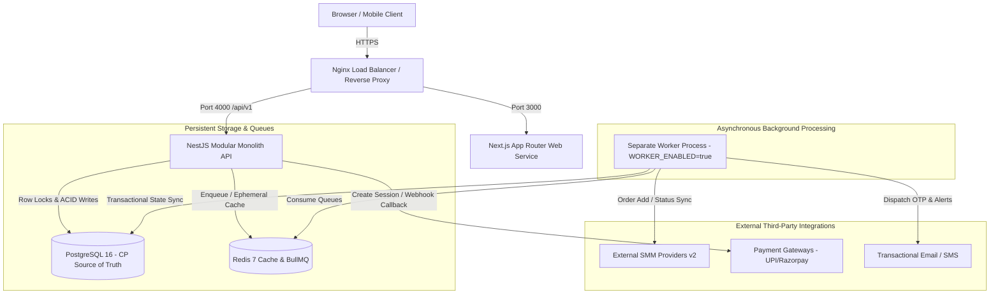
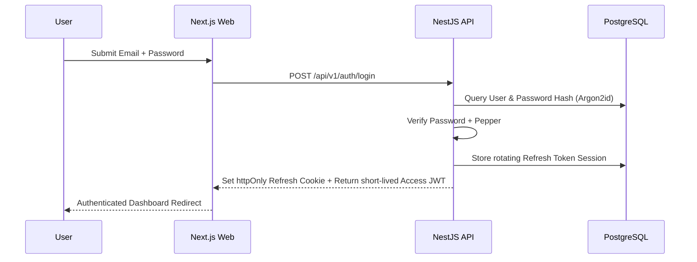
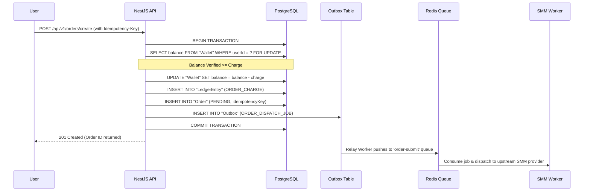
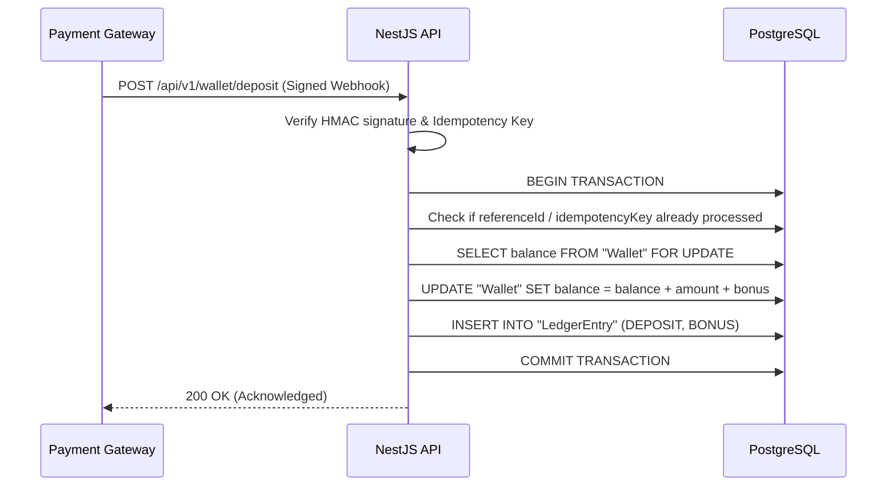

# 🌐 HLD 02: Frontend & Backend Architecture

**Status:** IMPLEMENTED  
**Date:** 2026-10-12  

---

## 1. System Context Diagram

---

## 2. Process Separation & Worker Verification

- **API Process Isolation (`apps/api`)**: The API runs stateless and serves HTTP REST routes on `/api/v1`. The API **never consumes queues**.
- **Worker Process Isolation (`apps/worker/src/main.ts`)**: Runs as a separate Node process guarded by `WORKER_ENABLED`. When `WORKER_ENABLED=false`, the process cleanly exits, preventing unintended queue consumption.
- **Queue Engine**: BullMQ with dedicated queues: `order-submit`, `order-sync`, `refund`, `notification`, and `outbox-relay`.

---

## 3. Core Request Flows

### A. Login Flow

### B. Place Order Flow (Money & Invariant Safety)

### C. Deposit Webhook Flow

---

## 4. Auth & Session Model

1. **Access Token**: Short-lived JWT (15 minutes lifespan) containing `sub` (User ID), `email`, and `role`. Verified statelessly on each request.
2. **Refresh Token**: Long-lived token (7 days) stored in an `httpOnly, Secure, SameSite=Strict` cookie.
3. **Session Rotation**: Every refresh request invalidates the previous refresh token and generates a new pair. Reuse of a revoked token triggers instant tenant session termination.
