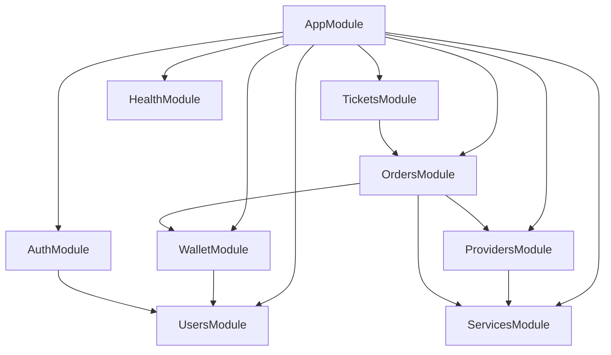

# 🧩 HLD 04: Modular Monolith Services & Boundaries

**Status:** IMPLEMENTED  
**Date:** 2026-10-12  

---

## 1. Domain Module Boundaries & Responsibilities

| Module | Primary Owner Responsibilities | Sync REST Calls | Async via Outbox -> BullMQ | Status |
| :--- | :--- | :--- | :--- | :--- |
| **Auth** | Login, register, Argon2id verification, JWT creation | `POST /auth/login`, `POST /auth/register` | Audit log event | **Implemented** |
| **Users** | Profile info, API keys, preferences | `GET /users/me`, `PUT /users/me` | User update events | **Implemented** |
| **RBAC** | Role permissions (Customer, Support, Admin) | Auth guard evaluation | Role assignment audit | **Implemented** |
| **Catalog** | Service catalog, rates per 1k, min/max limits | `GET /services`, `GET /services/:id` | Catalog cache purge | **Implemented** |
| **Orders** | Placement, validation, idempotency checks | `POST /orders/create`, `GET /orders` | Order dispatch job | **Implemented** |
| **Order-Engine** | Upstream provider communication & status sync | None (internal worker engine) | `order-submit`, `order-sync` | **Implemented** |
| **Wallet** | Balances, deposits, ledger bookkeeping | `GET /wallet/balance`, `POST /wallet/deposit`| Ledger sync & notifications | **Implemented** |
| **Payments** | Gateway webhooks, session initialization | Gateway webhook callback | Payment verified event | **Implemented** |
| **Refunds** | Automated partial/cancellation credits | Admin manual trigger | `refund` worker queue | **Implemented** |
| **Tickets** | Customer disputes & support messaging | `GET /tickets`, `POST /tickets/create` | Ticket notification job | **Implemented** |
| **Providers** | Upstream wholesaler balance polling | `GET /providers`, `POST /providers/:id/sync` | Provider sync daemon | **Implemented** |
| **Health** | Liveness & readiness probes | `GET /health/live`, `GET /health/ready` | None | **Implemented** |

---

## 2. Cross-Module Communication Rule

> **ARCHITECTURAL BOUNDARY MANDATE:**  
> Direct cross-module database table queries are strictly forbidden.  
> Modules must communicate exclusively via:
> 1. Exported NestJS injectable service methods.
> 2. Shared contracts and DTOs from `@smm/contracts`.
> 3. Transactional Outbox domain events relayed through BullMQ queues.

---

## 3. Module Dependency Graph

