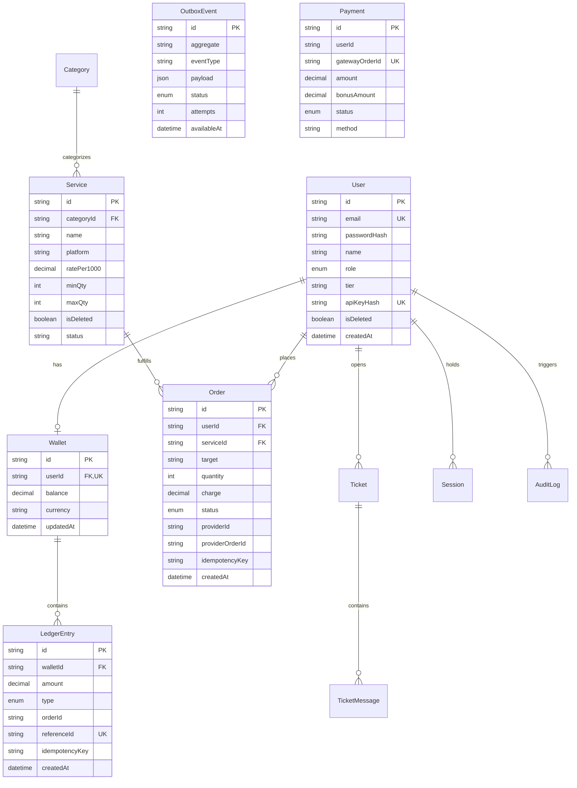

# 🗄️ LLD 01: Database Schema & Entity Relationship

**Status:** IMPLEMENTED  
**Date:** 2026-10-12  

---

## 1. Entity-Relationship Diagram (ERD)

---

## 2. Comparison with SRS §38 & Differences Analysis

| SRS §38 Requirement | Schema Implementation | Status | Justification / Design Decision |
| :--- | :--- | :--- | :--- |
| **Money Representation** | `Decimal(12, 2)` & `Decimal(10, 2)` | **Implemented** | Strict decimal precision prevents floating-point inaccuracy. |
| **Common Filter Indexes** | Indexed: `Order(userId, status, createdAt)`, `Order(providerId, status)`, `LedgerEntry(walletId, createdAt)`, `Service(platform, categoryId, status)` | **Implemented** | Eliminates table scans during high-throughput order queries. |
| **Soft Delete** | `isDeleted` and `deletedAt` on `User` and `Service` | **Implemented** | Preserves historical referential integrity for ledgers and past orders. |
| **Unique Idempotency per User** | `@@unique([userId, idempotencyKey])` on `Order` | **Implemented** | Guarantees exactly-once order placement per idempotency key per customer. |
| **Unique Payment per Gateway Order ID** | `@unique gatewayOrderId` on `Payment` | **Implemented** | Prevents duplicate deposits from gateway callbacks. |
| **Single Refund per Order Invariant** | `@@unique([orderId, type])` where `type = REFUND` on `LedgerEntry` | **Implemented** | Database-level unique constraint prevents multiple refunds for one order. |
| **Append-Only Audit Log** | `AuditLog` table with user, action, resource, payload, IP | **Implemented** | Immutable audit trail for compliance and administrative actions. |
| **Transactional Outbox Event** | `OutboxEvent` with `attempts` and `availableAt` | **Implemented** | Powers guaranteed async message relay to BullMQ without 2PC. |
| **Idempotent Seed** | `prisma/seed.ts` with upserts | **Implemented** | Provisions default admin, demo customer, reseller, and services. |
