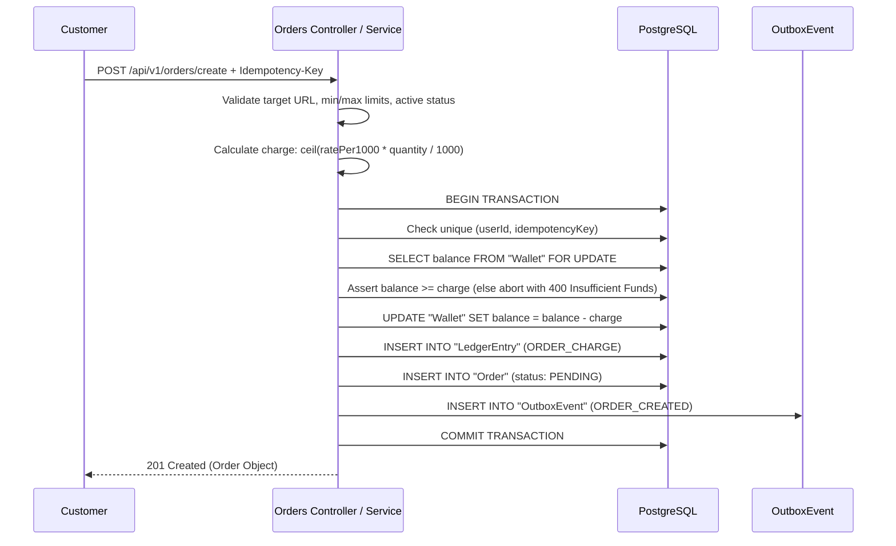
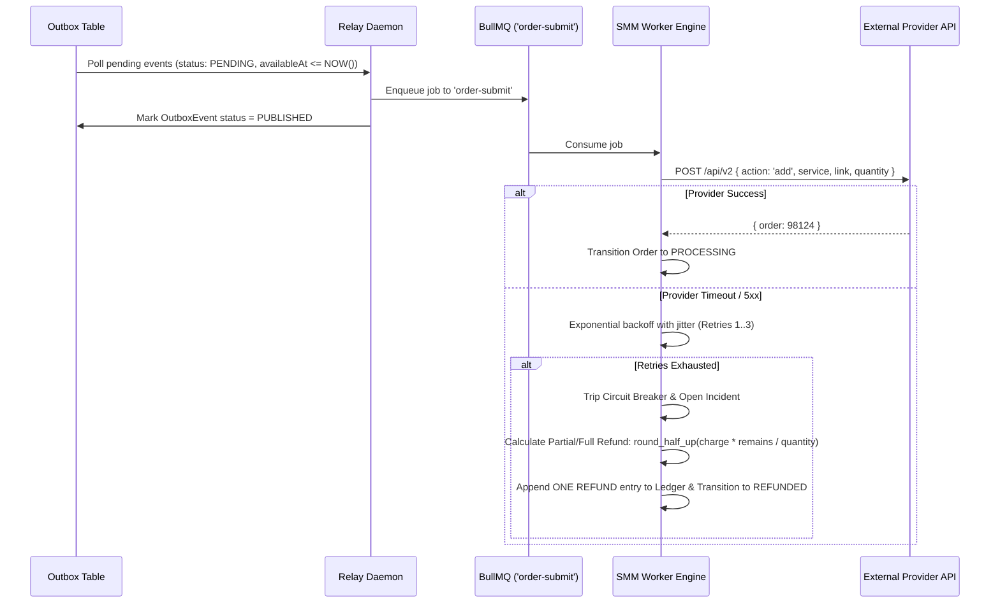

# ⚙️ LLD 03: Functionality, Sequence Flows & Invariants

**Status:** IMPLEMENTED  
**Date:** 2026-10-12  

---

## 1. Flow Sequence Diagrams & Business Rules

### A. Place Order Flow

**Business Rules:**
1. Server-side price calculation is authoritative: $\text{charge} = \lceil\frac{\text{ratePer1000} \times \text{quantity}}{1000}\rceil$.
2. Wallet row lock (`FOR UPDATE`) guarantees no concurrent race conditions can cause a negative balance.
3. Order creation, ledger debit, and outbox event write happen in **exactly one atomic transaction**.
4. Duplicate `Idempotency-Key` returns existing order without creating a duplicate charge.

---

### B. Outbox Relay -> BullMQ -> Provider Worker Engine

---

## 2. Order State Machine Transition Matrix

| Current State (`from`) | Permitted Next States (`to`) | Terminal? | Notes |
| :--- | :--- | :--- | :--- |
| **`PENDING`** | `PROCESSING`, `CANCELLED`, `FAILED` | No | Initial state after placement |
| **`PROCESSING`** | `IN_PROGRESS`, `COMPLETED`, `PARTIAL`, `CANCELLED`, `FAILED` | No | Acknowledged by worker / provider |
| **`IN_PROGRESS`** | `COMPLETED`, `PARTIAL`, `CANCELLED` | No | Active delivery |
| **`PARTIAL`** | `REFUNDED` | No | Triggers automated partial refund |
| **`CANCELLED`** | `REFUNDED` | No | Triggers automated full refund |
| **`FAILED`** | `REFUNDED` | No | Triggers automated full refund |
| **`COMPLETED`** | *None* | **YES** | Terminal success state |
| **`REFUNDED`** | *None* | **YES** | Terminal refund state |

Every illegal transition throws an authoritative `Illegal Order Status Transition` error and is exhaustively covered by `e2e/state-machine.spec.ts`.
