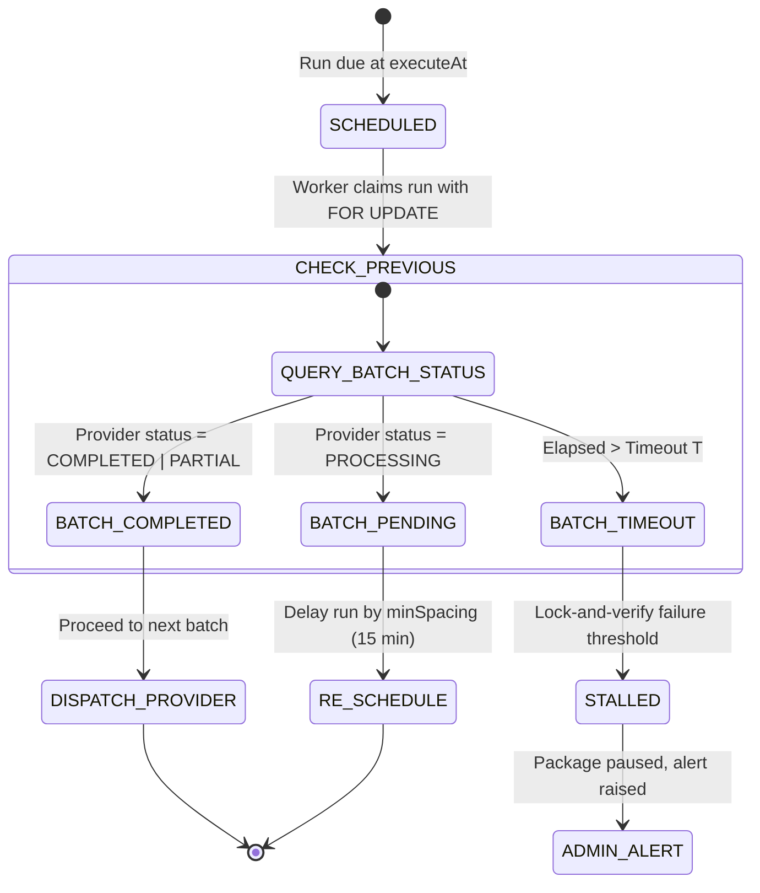
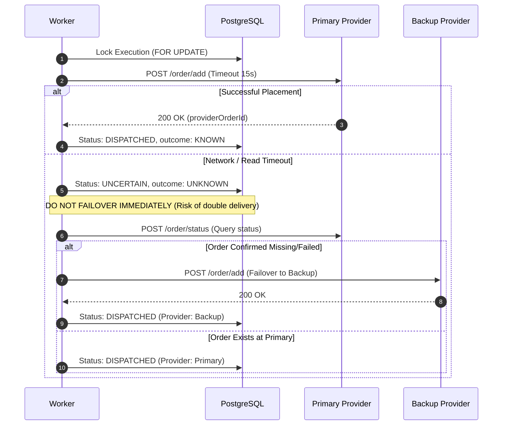

# Low-Level Design (LLD): Feature Batch 2

## 1. Schema Deltas & Migrations

### 1.1 Model: `Category` & `Service` Extensions
```prisma
// Delta for Service model
model Service {
  // Existing fields...
  categoryId               String?
  category                 Category? @relation(fields: [categoryId], references: [id], onDelete: SetNull)
  backupProviderId         String?
  backupProviderServiceId  String?
  geoCountry               String?   // e.g. "IN", "US", "GLOBAL"
  // ...
}
```

### 1.2 Model: `Package` Extensions
```prisma
model Package {
  // Existing fields...
  tierId                 String?        @default("STANDARD") // FAST, STANDARD, EXTENDED
  tierMultiplierSnapshot Decimal?       @db.Decimal(5, 4)
  autoRenew              Boolean        @default(false)
  renewalOfId            String?
  swapCount              Int            @default(0)
  pausedDays             Int            @default(0)
  pausedAt               DateTime?
  // ...
}
```

### 1.3 Model: `PackageRule` & `PackageExecution` Extensions
```prisma
model PackageRule {
  // Existing fields...
  targetCountry     String?
  targetState       String?
  windowStartHour   Int?      // 0..23 (Local customer hour)
  windowEndHour     Int?      // 0..23
  providerId        String?
  // ...
}

model PackageExecution {
  // Existing fields...
  providerBatchId   String?
  lastStatusCheckAt DateTime?
  outcome           ExecutionOutcome @default(KNOWN)
  // ...
}

enum ExecutionOutcome {
  KNOWN
  UNKNOWN
  STALLED
}
```

### 1.4 New Model: `PackageComment`
```prisma
model PackageComment {
  id        String   @id @default(uuid())
  packageId String
  ruleId    String
  text      String   @db.VarChar(500)
  seq       Int      @default(1)
  status    String   @default("PENDING") // PENDING, SENT, REJECTED
  createdAt DateTime @default(now())

  @@index([packageId, ruleId])
}
```

### 1.5 Model: `Favorite` Update
```prisma
model Favorite {
  id         String   @id @default(uuid())
  userId     String
  user       User     @relation(fields: [userId], references: [id], onDelete: Cascade)
  kind       String   @default("ORDER") // ORDER, PACKAGE
  configHash String   @db.VarChar(64)
  config     Json     // Full configuration payload
  createdAt  DateTime @default(now())
  updatedAt  DateTime @updatedAt

  @@unique([userId, configHash])
  @@index([userId, kind])
}
```

### 1.6 New Model: `StalledReport`
```prisma
model StalledReport {
  id        String   @id @default(uuid())
  orderId   String   @unique
  userId    String
  status    String   @default("OPEN") // OPEN, RESOLVED, DISMISSED
  reason    String
  createdAt DateTime @default(now())
  updatedAt DateTime @updatedAt

  @@index([userId, status])
}
```

---

## 2. API Endpoints Specification

### 2.1 Grouped Catalog: `GET /catalog/grouped`
- **Auth:** Public / Optional Bearer.
- **Query Parameters:** `platform?: string`
- **Response Format:**
  ```json
  {
    "categories": [
      {
        "id": "cat_instagram_followers",
        "name": "Instagram Followers",
        "slug": "instagram-followers",
        "serviceCount": 12,
        "services": [
          {
            "id": "srv_ig_hq",
            "name": "Instagram Followers [High Quality]",
            "ratePer1000": "85.00",
            "minQty": 100,
            "maxQty": 50000,
            "avgTime": "1 hour",
            "refillable": true,
            "cancellable": false,
            "description": "Stable followers with 30-day refill."
          }
        ]
      },
      {
        "id": "uncategorized",
        "name": "Other",
        "slug": "other",
        "serviceCount": 2,
        "services": [ ... ]
      }
    ]
  }
  ```
- **Constraints:** Returns in a single database aggregation. Excludes categories with zero active services.

### 2.2 Package State Actions
- `POST /packages/:id/pause`
  - Validates `package.status === ACTIVE`.
  - Sets `package.status = PAUSED`, `package.pausedAt = NOW()`.
  - Updates future `SCHEDULED` executions to `PAUSED`.
- `POST /packages/:id/resume`
  - Validates `package.status === PAUSED`.
  - Computes `pausedDeltaDays = ceil((NOW() - pausedAt) / 86400000)`.
  - Asserts `package.pausedDays + pausedDeltaDays <= MAX_PAUSED_DAYS_SETTING` (e.g. 14 days).
  - Shifts all future executions by `pausedDeltaDays`.
  - Sets `package.status = ACTIVE`, clears `pausedAt`.
- `POST /packages/:id/triggers/:tid/swap-link`
  - **Body:** `{ newTargetUrl: string, reason: string }`
  - Validates `swapCount < 2`.
  - Validates `newTargetUrl` matches package platform and handle.
  - Extracts `newMediaKey` and verifies `unique(packageId, newMediaKey)`.
  - Updates trigger URL and unexecuted future executions. Increments `swapCount`.
- `POST /packages/:id/speed-up`
  - **Body:** `{ speedFactor: number }` (Range: 1.25x to 2.0x).
  - Asserts new calculated interval $\ge \text{platform.minGapMinutes}$ (e.g. 15 min) and $\ge 1$ hour.
  - Recalculates remaining execution timestamps within original `endAt` boundary.
- `POST /orders/:id/report-problem`
  - **Rate Limit:** 3 reports per user per hour.
  - Validates order belongs to user and is not in terminal `COMPLETED` state.
  - Inserts `StalledReport(orderId, userId, reason)`.
  - Sets package queue to `STALLED` and schedules immediate provider health check.

---

## 3. State Machines & Execution Workflows

### 3.1 Lock-and-Verify Batch Execution Flow


### 3.2 Provider Dispatch & Failover Sequence

