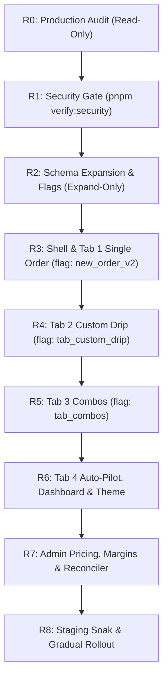

# Phased Release Plan & Live Data Risk Matrix (R0.d)

**Document:** `docs/releases/PLAN.md`  
**Author:** Principal Full-Stack Engineer  
**Date:** 2026-10-29  
**Branch:** chore/fastify-migration  
**Live Target:** Production VPS (`103.216.168.152`)  

---

## 1. Phased Release Roadmap

### **Release Breakdown & Gates**

1. **R0 — Production Audit (Read-Only) [CURRENT STEP]**
   - Deliverables: `docs/LIVE_FACTS.md`, `docs/NEW_ORDER_AS_BUILT.md`, `docs/NEW_ORDER_GAP.md`, `docs/releases/PLAN.md`.
   - Gate: Verified fact base, no production modifications.

2. **R1 — Security Gate & Financial Invariants**
   - Prerequisite Gate: All 9 checks in `pnpm verify:security` green.
   - Requirements: Bound `quoteHash`, rate-limited & authenticated quote endpoint, canonical refund logic, zero secret fallbacks, fail-closed database posture.
   - Constraint: Tabs 2–4 and money routes are blocked from release until R1 passes.

3. **R2 — Expand-Only Schema, Flags & Bootstrap API**
   - Deliverables:
     - Expand-only Prisma migration: `Service.kind` (LIKES, VIEWS, FOLLOWERS, SUBSCRIBERS, COMMENTS, REACH, IMPRESSIONS, SHARES, SAVES, OTHER), `geoCountry`, `geoRegion`.
     - PlatformConfig additions (`durationChips`, `dripIntervals`, `enabledTabs`).
     - Package v2 Models: `PackageTemplate`, `PackageTemplateTier`, `PackageTemplateItem`, `PackageSlot`, `PackageDraft`, `TemplateDailySales`, `PricingSettings`.
     - System feature flags with user allowlist, percentage rollout, and kill switch.
     - `GET /new-order/bootstrap?platform=` Redis-cached (60s) endpoint.
   - Gate: Previous code runs against new schema without regression; lock_timeout set; backward compatibility verified.

4. **R3 — Shell & Tab 1 (Single Order V2)**
   - Flag: `new_order_v2` (Default OFF; admin allowlist first).
   - Deliverables: 4-tab shell with URL sync (`?tab=&platform=`), sticky summary column, drafts per tab with dirty warning, strict WHATWG link validation, quantity min/max/step, optional drip feed, quote freshness validation.
   - Deploy Pack: `docs/releases/R3/DEPLOY.md`.

5. **R4 — Tab 2 (Custom Drip)**
   - Flag: `tab_custom_drip` (Default OFF).
   - Deliverables: Profile vs post URL discrimination, item cards (Likes, Views, Shares, Followers time-drip), duration chips + hours slider, fastest-possible warning, quote timeline chart, single-transaction purchase.

6. **R5 — Tab 3 (Combo Packages)**
   - Flag: `tab_combos` (Default OFF).
   - Deliverables: Fixed and Computed pricing models, largest-remainder integer paise allocation, allocated share refunds, margin floor guard ($409$ conflict if margin breached), immutable tiers once sold, daily caps, combo catalog UI & compare drawer.

7. **R6 — Tab 4 (Auto-Pilot), Package Controls, Dashboard V2 & Themes**
   - Flags: `tab_autopilot`, `dashboard_v2`, `theme_light`.
   - Deliverables: Slot activation (CAS `AVAILABLE` to `ACTIVE`), Pause/Resume with max extension, Swap Link (audit logged, max 2), single-refund cancellation, Problem report ticket flow, KPI cards, Planned vs Delivered hourly chart, Light/Dark theme CSS token engine.

8. **R7 — Admin Controls, Margin Engine & Reconciler**
   - Deliverables: Pricing settings, combo templates editor with live margin preview, nightly automated reconciler (ledger vs wallet, executions vs provider status).

9. **R8 — Staging Soak & Phased Rollout**
   - Deliverables: Full gate on staging copy DB, canary rollout schedule (Admins $\rightarrow$ 5% $\rightarrow$ 25% $\rightarrow$ 100%), rollback thresholds, production smoke test runbook.

---

## 2. Live Data Risk Matrix & Mitigations

| Live Asset | Risk Description | Severity | Mitigation & Invariant Guard |
| :--- | :--- | :--- | :--- |
| **Existing Packages (`Package`, `PackageRule`)** | Schema expansion could break active packages or scheduled executions. | **CRITICAL** | **Expand-Only Migrations (L2):** Zero column drops or renames. Default values on all new columns. Existing `PackageRule` rows continue running through legacy worker handlers. |
| **Reserved Wallet Balances (`Wallet.balance`, `reserveTotal`)** | Double-debit or orphaned reserve during refund/cancellation. | **CRITICAL** | **Invariant $W_{avail} + W_{res} = \sum L$:** All wallet balance changes must occur in an explicit database transaction with `FOR UPDATE` locks and write a paired `LedgerEntry`. |
| **Existing Instagram Retainers** | New slot-based Auto-Pilot schema might conflict with handle-based retainers. | **HIGH** | Retainers run under legacy mode (`kind = POST_ACTIONS`). New packages use explicit `mode = TEMPLATE | CUSTOMIZED | CUSTOM`. |
| **In-Flight Orders & Provider Dispatches** | Worker queue contention or lock timeout during migrations. | **HIGH** | Migrations execute with `SET lock_timeout = '2s'; SET statement_timeout = '10s';`. Non-blocking `CREATE INDEX CONCURRENTLY`. |
| **Upstream Provider Rate Fluctuations** | Provider prices rise above package purchase price, creating negative margins. | **HIGH** | **Margin Guard (SRS §50):** Every combo template and purchase verifies margin floor against live catalog rates before locking the transaction. |

