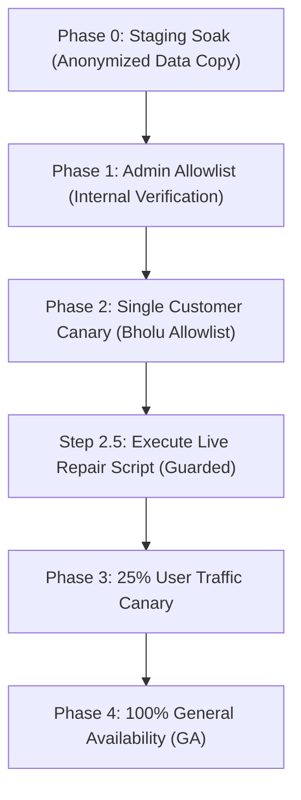

# Production Rollout & Staging Soak Plan (Drip Delivery V2 & Delivery Pace)

**Document:** `docs/releases/ROLLOUT.md`  
**Git Commit:** `a52981bfd4b99b284901d431aaa1a1999b9c7ebd`  
**Git Branch:** `chore/fastify-migration`  
**Database:** `neondb` (Neon Postgres, expand-only, zero column drops/renames)  
**Safety Protocol:** Feature Flag Canary Rollout, Zero-Downtime, Guarded Repair Script, Instant Kill Switch  
**Deployment Constraint:** Strictly LOCAL verification — ZERO code pushed to production VPS until explicit operator signoff.

---

## 1. Feature Flag Architecture & Safe Defaults

All Delivery Pace scheduling logic, per-link dispatcher rate-limiting, table-driven provider error classification, and catch-up throttling are isolated behind two distinct, expand-only feature flags in `SystemSetting.feature_flags`. Both flags default strictly to `OFF` (`false`).

| Flag Name | Scope | Default | Description |
| :--- | :--- | :---: | :--- |
| `drip_v2` | Worker Dependency & Error Classification | `false` | Enables terminal-state predecessor unblocking (allowing chains to proceed when prior run FAILED/PARTIAL), table-driven error classification, canonical single-run refunds, and STALLED watchdog alerts. |
| `delivery_pace` | Pure Scheduler & Per-Link Dispatch Limiter | `false` | Enforces deterministic rate caps (`units/hour`), pure integer-conserving schedule calculation, per-link in-flight concurrency caps, and backlog catch-up throttling ($K \le 2$ runs/tick). |

---

## 2. Phased Rollout Sequence



### Phase 0: Staging Soak (Anonymized Snapshot)
- **Environment:** Dedicated staging database populated from an anonymized production dump (all emails, target URLs, handles masked).
- **Duration:** 24 Hours continuous simulation.
- **Verification:**
  - Replay of H0 burst scenario: 24 stuck executions unblocked in parallel.
  - Verify dispatcher emits at most $K=2$ runs per package per worker tick.
  - Confirm units dispatched per hour on `instagram.com/reel/***` never exceed `DEFAULT_KIND_PACE_CAPS.LIKES` (150/hr).
- **Exit Criteria:** 100% test pass; zero burst spikes; zero unbounded flushes.

### Phase 1: Admin Allowlist Only
- **Target:** System administrator accounts only.
- **Flag Configuration:**
  ```json
  {
    "drip_v2": { "enabled": false, "allowlist": ["usr_admin_uuid"] },
    "delivery_pace": { "enabled": false, "allowlist": ["usr_admin_uuid"] }
  }
  ```
- **Duration:** 12 Hours.
- **Verification:**
  - Admin places test campaign orders with pacing.
  - Verify quote breakdown shows real delivery pace and estimated finish times.
  - Admin Pace Audit screen (`GET /api/v1/settings/pace/audit`) renders top active links cleanly.

### Phase 2: Single Affected Customer Canary (Canary Allowlist)
- **Target:** Affected customer account (`Bholu`) whose packages experienced chain blocking.
- **Flag Configuration:**
  ```json
  {
    "drip_v2": { "enabled": false, "allowlist": ["usr_admin_uuid", "usr_bholu_uuid"] },
    "delivery_pace": { "enabled": false, "allowlist": ["usr_admin_uuid", "usr_bholu_uuid"] }
  }
  ```
- **Duration:** 24 Hours.
- **Verification:**
  - Verify customer dashboard shows real order statuses (`In queue`, `Processing`, `Completed`), not generic batches.
  - Verify "My Packages" displays active purchased packages.

### Step 2.5: Execution of Live Repair Script
- **Prerequisite:** Phase 2 flags are active and telemetry confirms stable worker cycles.
- **Action:** Execute `scripts/repair/stuck-executions.ts` with explicit confirmation token:
  ```bash
  npx tsx scripts/repair/stuck-executions.ts --apply --confirm-token=APPROVE_LIVE_DRIP_REPAIR_20261101
  ```
- **Repair Decisions:**
  - `FAIL-AND-REFUND` for 3 permanently failed executions: issues canonical refund of ₹57.93 (5,793 paise) via immutable ledger transactions.
  - `RESCHEDULE` for 21 chain-delayed executions: schedules them with deterministic spacing (at most 2 runs per tick) to prevent backlog flush.

### Phase 3: Gradual Public Rollout
- **25% Rollout (48 Hours):** Monitor error rates, retry counts, and customer support tickets.
- **50% Rollout (48 Hours):** Confirm database query latency on `PackageExecution` remains under 15ms with index scan.

### Phase 4: 100% General Availability (GA)
- **Flag Configuration:**
  ```json
  {
    "drip_v2": { "enabled": true, "percentage": 100 },
    "delivery_pace": { "enabled": true, "percentage": 100 }
  }
  ```
- **Final Soak Period:** 14 Days before scheduling legacy table cleanup.

---

## 3. Observability & Telemetry Watchpoints

During each rollout phase, operators and automated monitors must track:

1. **Units Dispatched Per Hour per Normalized Link:**
   - Query: `GET /api/v1/settings/pace/audit`
   - Threshold: Dispatched units in any 60-minute rolling window must never exceed kind cap (Likes: 150/hr, Views: 500/hr, Shares: 30/hr).
2. **STALLED Execution Gauge:**
   - Metric: Count of package executions in non-terminal state older than `DEFAULT_STALL_TIMEOUT_MS` (12 hours).
   - Threshold: Alert triggered if STALLED count $> 0$.
3. **Provider Error Class Distribution:**
   - Monitor breakdown: `DEFINITE_REJECTION` (auto-failed & refunded), `RETRY_LATER` (exponential backoff), `AMBIGUOUS` (held for status query).
   - Threshold: Alert if `AMBIGUOUS` exceeds 2% of total dispatches.
4. **Canonical Refund Ledger Integrity:**
   - Financial Invariant: $\text{Purchased} = \text{Consumed} + \text{Refunded} + \text{Remaining}$.
   - All refunds must correspond 1:1 with an immutable `LedgerEntry` in integer paise.
5. **Support Ticket Velocity:**
   - Zero customer complaints regarding sudden engagement jumps or frozen package chains.

---

## 4. Emergency Kill Switch & Rollback Plan

### Instant Kill Switch (Zero Downtime)
If any anomaly occurs, both flags can be reverted immediately via the Admin Settings API or database query without restarting PM2 or deploying code:

```sql
UPDATE "SystemSetting"
SET "value" = jsonb_set(
  jsonb_set("value", '{drip_v2,enabled}', 'false'::jsonb),
  '{delivery_pace,enabled}', 'false'::jsonb
)
WHERE "key" = 'feature_flags';
```

### Rollback Thresholds
Immediate kill switch activation is mandatory if:
- STALLED execution count exceeds 5 across all active packages.
- Any link exceeds its hourly pace cap by $> 10\%$.
- Unhandled HTTP 5xx or provider synchronization exceptions exceed 1% in worker logs.
- Discrepancy detected in integer paise ledger reconciliation.

---

## 5. Technical Debt & Cleanup Backlog (Deferred)

Per architectural guidelines, the following legacy cleanup items are explicitly **deferred** to a future maintenance release after Delivery Pace has soaked in production for 14+ days:

1. **`OrderRun` Table Deprecation:**
   - Deprecate and drop `OrderRun` table once all legacy single-order drip rows have concluded.
2. **Remove Deprecated Standalone Drip Code Path:**
   - Remove redundant legacy drip branches in `orders.service.ts` and consolidate entirely onto `PackageExecution`.
3. **Modularize Worker `main.ts`:**
   - Refactor `apps/worker/src/main.ts` into isolated domain services (`PacedDispatcherService`, `StatusSyncWatchdogService`, `ProviderPollerService`).

---

## 6. VPS Deployment Safety Confirmation

- **Code Push Status:** **ZERO CODE PUSHED TO VPS**.
- All changes, property-based tests, Next.js build compilation, forbidden words grep gates, and dry-run repair simulations have been executed strictly in local workspace.
---

## 7. YouPI-PG Pilot Rollout Plan (Self-Hosted UPI Gateway Pilot)

### 7.1 Prerequisites Checklist
Before enabling the YouPI pilot in production, all of the following checkboxes MUST be verified:
- [ ] **Bank Written Confirmation**: Commercial confirmation obtained from receiving bank regarding business UPI transaction terms and statement export formats.
- [ ] **Legal & Compliance Review**: Legal review completed regarding non-instant, manual-reconciliation pilot wallet credits under RBI guidelines.
- [ ] **Dedicated Bank Account & SIM**: Completely isolated bank account used solely for the pilot (never mixed with primary operations or personal finances).
- [ ] **Dedicated Pilot Phone**: Android observer installed only on a clean, dedicated physical phone holding the pilot bank SIM, with no external personal apps.
- [ ] **Observer Hardening**: Gmail OAuth credentials restricted to read-only alert forwarding mailbox; Android notification listener restricted.
- [ ] **Pilot Acknowledgement Record**: Stored in DB via Admin Portal (`adminName`, `signedAt`, confirmation text). The feature flag is code-locked and will refuse to activate if this record is missing.
- [ ] **Hard Ceiling Caps Enforced**: Daily attempts ceiling $\le$ 20 per receiving account (as specified in upstream YouPI README); individual transaction caps: Min ₹100, Max ₹5,000.
- [ ] **Monitoring & Heartbeats**: Heartbeat alerts configured for observers; admin email/Telegram alerts wired for `SUSPICIOUS` events.

### 7.2 Phased Flag Order
1. **Phase 0: Internal Dry-Run (Hours 0–24)**
   - `YOUPI_PILOT_ENABLED = true`
   - `allowlistedUserIds = ["<INTERNAL_ADMIN_USER_ID>"]`
   - Only 1 internal admin account can see and initiate UPI pilot top-ups.
   - Run 2 end-to-end test top-ups (₹100 each). Verify webhook delivery, statement CSV matching, and wallet credit.
2. **Phase 1: Limited Friendly Customer Pilot (Days 2–7)**
   - Add exactly 2 to 3 trusted power-user IDs to `allowlistedUserIds`.
   - Never enable globally (`*`) or for un-allowlisted users.
   - Total daily top-up attempts hard-capped at 20 across all users.
3. **Phase 2: Evaluated Expansion (Days 8–14)**
   - Maximum 10 allowlisted users.
   - Requires 0 unresolved `SUSPICIOUS` events and 100% daily bank statement reconciliation match rate.

### 7.3 Daily Limits within Upstream Guidelines
- **Daily Attempts Cap**: 20 attempts / 24 hours per receiving account (README research project guideline).
- **Daily Amount Cap**: ₹25,000 total per receiving account per day.
- **Per-User Daily Cap**: 2 top-ups per user per day.
- **Dual-Approval Threshold**: Any top-up $\ge$ ₹2,000 requires two separate administrators to confirm before wallet credit.

### 7.4 Operational Monitoring: What to Watch
- **Webhook Delivery Failures**: Rate of non-200 webhook responses or signature rejections (`YoupiWebhookDelivery.signatureOk = false`).
- **Observer Heartbeats**: Alert if observer heartbeat timestamp is older than 15 minutes during active banking hours.
- **SUSPICIOUS Count**: Any top-up marked `SUSPICIOUS` (amount mismatch, duplicate UTR, currency mismatch, or expired match) generates immediate admin notifications.
- **Unmatched Bank Rows**: Daily count of bank statement rows that do not match any initiated top-up.
- **Customer Support Tickets**: Any support inquiry referencing YouPI top-up order refs or delayed credits.

### 7.5 Daily Manual Reconciliation (First 14 Days)
Every evening at 23:00 IST:
1. Operator downloads the day's official transaction CSV from netbanking.
2. Operator navigates to `/admin/payments/youpi-pilot` and uploads the CSV.
3. The reconciliation engine matches rows by exact UTR and amount in paise against `OBSERVED` top-ups.
4. Operator verifies that every credited wallet deposit has a corresponding reconciled bank ledger entry.
5. Invariant check: `Total Credited Paise in SMM == Total Reconciled Bank Inflows`.

### 7.6 Exact Rollback & Emergency Kill-Switch Steps
1. Go to `https://smm-admin.domain.com/admin/payments/youpi-pilot`
2. Toggle **Kill Switch** to `ON`.
   - *Result*: All subsequent attempts to initiate a pilot top-up are immediately rejected with `403 Pilot temporarily disabled`.
3. Or via environment variable: Set `YOUPI_PILOT_ENABLED=false` and reload API (`pm2 reload smm-api`).
4. Reverting user access: Clear `allowlistedUserIds` in settings. Active initiated sessions will expire in 15 minutes with no credits issued.

### 7.7 Incident Response Plan: Suspected Spoofed Alert
If an alert is received with a forged SMS, spoofed email, or fake bank push notification:
1. **Freeze**: Immediately activate the Kill-Switch.
2. **Reverse Nothing Automatically**: Never programmatically deduct or alter balances based on webhook status updates.
3. **Audit**: Review `YoupiObservation` and raw webhook payloads in `YoupiWebhookDelivery`.
4. **Manual Bank Verification**: Check official netbanking statement directly. Top-ups can only be credited if the money is settled in the bank account.
5. **Mark Suspicious / Reject**: If confirmed spoofed, click **Reject** with reason `Spoofed SMS/alert detected - no bank credit entry found`. Top-up transitions to `REJECTED`.

